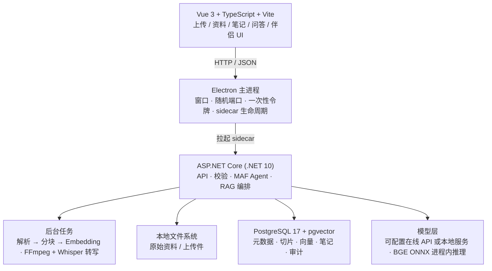

<div align="center">

# 知间 · KnowSpace

**本地优先的个人知识库** —— 资料入库、向量检索、带引用的问答，并把知识库通过 MCP 开放给外部 AI 工具。

[](https://dotnet.microsoft.com/)
[](https://vuejs.org/)
[](https://www.electronjs.org/)
[](https://www.postgresql.org/)
[]()

</div>

> **命名说明**：产品名是**知间**，GitHub 仓库名是 **KnowSpace**，代码内部标识沿用 `MyFirstMafAgent`（程序集、exe、环境变量前缀 `MAF_`）。三者指同一个项目。

---

## 这是什么

把散落在硬盘里的学习资料（PDF、Word、Markdown、图片、音视频）收进一个本地知识库，自动解析、切分、向量化，然后用自然语言提问 —— 回答**带原文引用**，可以点回出处。

与「把文件丢给云端 AI」的关键区别：

- **数据在你手里**。原始文件存在本地磁盘，元数据/切片/向量存在随包分发的 PostgreSQL，不经过任何第三方存储。
- **回答可追溯**。每条结论都附引用片段与相似度，音视频引用能直接跳到「第几分几秒」。
- **能力可对外开放但受控**。外部 AI 工具通过 MCP 接入时，能精确限定「读哪些库、调哪些工具、每分钟几次」，并全量审计。

## 功能一览

| 模块 | 能力 |
| --- | --- |
| **我的资料** | 上传 PDF / DOCX / TXT / MD / HTML / 常见图片 / 视频 / 音频（MP3、WAV、M4A、AAC、OGG、OPUS、FLAC、WEBA、AMR）；处理进度、摘要、失败原因；卡片直接显示图片缩略图、内联播放音频 |
| **AI 知识问答** | 混合检索（向量 + 词法，RRF 融合）+ 重排；带引用回答；工具增强模式（联网搜索、本地文件访问）；问答历史新建/重命名/批量删除/Markdown 导出 |
| **学习笔记** | 笔记 CRUD、置顶、按资料反查引用、导出；可从问答回答一键存为笔记 |
| **我的专题** | 按专题归类资料，侧栏与资料页联动筛选；删除专题只解除归属，不删资料 |
| **AI 伴侣** | 导入通用聊天记录（UTF-8 JSON/TXT），生成表达风格描述，基于历史样本独立对话 |
| **我的分身** | 投喂日记、聊天记录、性格与形象描述，提炼可复用人格洞察，用第一人称回答「如果是我会怎么做」 |
| **任务中心** | 长任务并发调度、类型配额、租约与重试、事件流 |
| **插件平台** | 独立子进程 + JSON-RPC over stdio；Windows AppContainer / Linux bubblewrap 真隔离；清单签名校验、权限授予、调用配额、审计 |
| **MCP** | 既是**服务端**（把知识库开放给 Cursor / Claude / 自研 Agent），也是**客户端**（让聊天模型调用外部 MCP 工具） |

## 架构



**关键设计取舍**

- **后端是一体的**：API + 便携 PostgreSQL + Embedding 模型 + ffmpeg 打成一个可分发单元。装完即用，不需要用户自己装数据库。
- **Electron 只是壳**：只负责窗口、端口分配、令牌注入与子进程生命周期，不含业务逻辑。同一份后端可以跑成桌面版、控制台版或容器。
- **单一组合根**：桌面宿主与控制台宿主共用 `ApiHost.BuildAsync`，避免两套 HTTP 行为。
- **启动有指纹快路径**：数据库结构未变时跳过全部 DDL 与目录查询，后端就绪从 3.8–5.1s 降到 1.4s 左右。

## 快速开始

### 方式一：Windows 安装包（最省事）

从 [Releases](https://github.com/1Oldcoin/KnowSpace/releases) 下载 `MyFirstMafAgent-x.y.z-setup.exe`，双击安装。

- 用户数据在 `%LOCALAPPDATA%\MyFirstMafAgentData`，卸载不会删除
- 首次启动会在后台初始化便携数据库（约 5–10 秒），之后约 1.5 秒

> 安装包目前**未做代码签名**，首次运行 Windows SmartScreen 会提示「未知发布者」，选择「更多信息 → 仍要运行」即可。

### 方式二：Docker（Linux 服务器）

```bash
git clone https://github.com/1Oldcoin/KnowSpace.git
cd KnowSpace

cat > .env <<'EOF'
LLM_API_KEY=sk-your-key
MAF_SERVER_TOKEN=<openssl rand -hex 32>
PG_PASSWORD=<强口令>
EOF

docker compose up -d --build
```

浏览器打开 <http://localhost:5056>。

> 默认只绑 `127.0.0.1`。**对外暴露前必读 [`docs/CLOUD-DEPLOYMENT.md`](docs/CLOUD-DEPLOYMENT.md)** —— 需要配反向代理、TLS 与 `MAF_SERVER_TOKEN`，否则 `/api` 是不鉴权的。

### 方式三：从源码开发

前置：**.NET 10 SDK**、**Node.js 22.18+ 或 24.12+**

```bash
# 后端（首次会自动 initdb 便携数据库）
dotnet run --project MyFirstMafAgent.Api
# → http://127.0.0.1:5056

# 前端热重载（另开一个终端）
cd FrontEnd/myfist-agent
npm install
npm run dev
# → http://localhost:5173（已加入 CORS 白名单）
```

构建前端并交给后端托管：

```bash
cd FrontEnd/myfist-agent && npm run build
# 把 dist/{index.html,assets} 复制到 MyFirstMafAgent.Api/wwwroot
```

桌面壳：

```bash
cd desktop-electron
npm install
npm start          # 开发运行
npm run dist:full  # 打包 NSIS 安装包
```

**原生工具（可选）**：`MyFirstMafAgent.Api/ExternalTools/` 下的 ffmpeg / Embedding 模型 / 便携 PostgreSQL **不入库**（体积大、含单文件超 100 MB 的二进制）。按需装配：

```powershell
powershell -ExecutionPolicy Bypass -File scripts\Download-ExternalTools.ps1 -Target all
```

缺任何一个都不会导致启动失败：ffmpeg 缺失时视频功能报可读错误，便携数据库缺失时回落到外部 PostgreSQL 连接串。

## 把知识库接给外部 AI（MCP）

三步。先在应用内「设置 → MCP 客户端」建一个密钥（明文只显示一次）：

```jsonc
// Cursor: ~/.cursor/mcp.json
{
  "mcpServers": {
    "knowspace": {
      "url": "https://knowspace.example.com/mcp",   // 本机则 http://127.0.0.1:5056/mcp
      "headers": { "X-Api-Key": "maf_xxxxxxxxxxxxxxxx" }
    }
  }
}
```

```bash
# 或者直接 JSON-RPC
curl -X POST http://127.0.0.1:5056/mcp \
  -H "Content-Type: application/json" \
  -H "X-Api-Key: maf_xxxxxxxxxxxxxxxx" \
  -d '{"jsonrpc":"2.0","id":1,"method":"tools/list"}'
```

**授权模型**是三级收窄：

```
能力（knowledge:read / knowledge:write / workspace:* / files:* / avatar:* / chat:read）
  └→ 工具白名单（可选，进一步限定到具体工具名）
      └→ 知识库白名单（可选，限定能操作哪些库）
```

再加逐客户端令牌桶限流、按 IP 的鉴权失败封禁、全量调用审计。
**清单外的工具默认拒绝** —— 新增工具忘了登记是「不可用」，不是「对所有人开放」。

完整说明：[`docs/MCP-ACCESS.md`](docs/MCP-ACCESS.md)（速查）· [`docs/MCP-INTEGRATION-MANUAL.md`](docs/MCP-INTEGRATION-MANUAL.md)（整合版）

## 文档

| 文档 | 内容 |
| --- | --- |
| [`ARCHITECTURE.md`](ARCHITECTURE.md) | 系统架构、模块划分、关键设计决策与踩过的坑（**改动前先读**） |
| [`PROJECT_DOCUMENTATION.md`](PROJECT_DOCUMENTATION.md) | 已实现功能的代码落点索引，按文件逐个说明职责 |
| [`docs/ROADMAP.md`](docs/ROADMAP.md) | 技术债、待做功能、明确不做的事（留档避免反复讨论） |
| [`docs/DEPLOYMENT.md`](docs/DEPLOYMENT.md) | 跨平台部署口径：三种交付形态、平台矩阵、原生工具解析规则 |
| [`docs/CLOUD-DEPLOYMENT.md`](docs/CLOUD-DEPLOYMENT.md) | **云服务器部署与 MCP 接入**：安全清单、Docker/systemd/Windows 三种形态、密钥生命周期 |
| [`docs/MCP-ACCESS.md`](docs/MCP-ACCESS.md) | MCP 接入速查：三步接入、能力词表、排错 |
| [`docs/MCP-INTEGRATION-MANUAL.md`](docs/MCP-INTEGRATION-MANUAL.md) | MCP 两个方向（服务端 / 客户端）的完整说明书 |
| [`docs/JOBS.md`](docs/JOBS.md) | 任务中心：并发、配额、租约、重试与事件流 |
| [`docs/PLUGIN-DEVELOPER-MANUAL.md`](docs/PLUGIN-DEVELOPER-MANUAL.md) | 插件开发说明书（从零到发布） |
| [`docs/PLUGIN-DEVELOPMENT-GUIDE.md`](docs/PLUGIN-DEVELOPMENT-GUIDE.md) | 插件开发分阶段教程 |
| [`docs/PLUGIN-LIFECYCLE.md`](docs/PLUGIN-LIFECYCLE.md) | 插件生命周期与安全口径 |
| [`docs/PLUGIN-AUTHOR-GUIDE.md`](docs/PLUGIN-AUTHOR-GUIDE.md) | 插件清单速查 |
| [`docs/PHASE0-BASELINE.md`](docs/PHASE0-BASELINE.md) | 阶段 0 的延迟/索引基线（历史存档） |
| [`desktop-electron/README.md`](desktop-electron/README.md) | 桌面壳：启动/退出时序、启动画面定制、自动更新 |

## 仓库结构

```
MyFirstMafAgent.Api/          ASP.NET Core 后端（组合根 ApiHost + Hosting/ 模块化注册）
  Hosting/                    启动顺序、中间件管线、数据库初始化、MCP 准入闸门、安全
  Domain/                     领域模型与纯函数策略（可脱库穷举测试）
  Application/                用例层（客户端管理、检索路由、索引生命周期…）
  Endpoints/                  REST 端点（Minimal API）
  Mcp/                        MCP 工具实现（知识库 / 文件 / 分身 / 聊天历史）
  Plugins/                    插件运行时与隔离
  Infrastructure/             SqlSugar 持久化、便携 PostgreSQL、Embedding、日志
  ExternalTools/              原生二进制（不入库，按需装配）
MyFirstMafAgent.Api.Tests/    xUnit 测试
MyFirstMafAgent.Plugins.Sdk/  插件 SDK（第三方插件引用）
FrontEnd/myfist-agent/        Vue 3 + TS + Vite 前端
desktop-electron/             Electron 主进程与打包配置
scripts/                      发布、测量、E2E 验证脚本
samples/                      示例插件
docs/                         文档
```

## 安全模型

| 面 | 使用者 | 凭据 | 说明 |
| --- | --- | --- | --- |
| `/api` | 界面 | `X-Api-Token` | 桌面：每次启动重新生成、不落盘；服务端：长期令牌或反向代理注入 |
| `/mcp` | 外部 Agent | `X-Api-Key` / `Bearer` | 长期密钥，只存 SHA-256 哈希 + 前缀，明文仅创建时出现一次 |
| 静态资源 | 浏览器 | 无 | 首页与 `assets/*` |

其它已实现项：插件真隔离（AppContainer / bubblewrap）+ 清单签名校验、SSRF 防护（含云元数据地址段）、
`/api/desktop/*` 回环限制、全局安全响应头、`Server` 头隐藏、请求体上限。

细节与部署清单见 [`docs/CLOUD-DEPLOYMENT.md`](docs/CLOUD-DEPLOYMENT.md)。

## 当前状态

项目处于**自用演进**阶段：功能完整可用，接口与配置项仍可能调整。

- ✅ 已完成：知识库全链路、混合检索、MCP 双向、插件平台、桌面安装包、Docker 部署
- 🚧 进行中：自动更新发布链路（安装包与 `latest.yml` 已产出，尚未接真实更新源）
- ⚠️ 已知限制：安装包未代码签名；单用户（无多用户体系）；MCP 密钥无有效期字段

详见 [`docs/ROADMAP.md`](docs/ROADMAP.md)。

## 许可

本仓库暂未附带开源许可文件。**在补充 LICENSE 之前，默认保留所有权利** ——
如需引用或二次分发，请先通过 Issue 联系作者。
