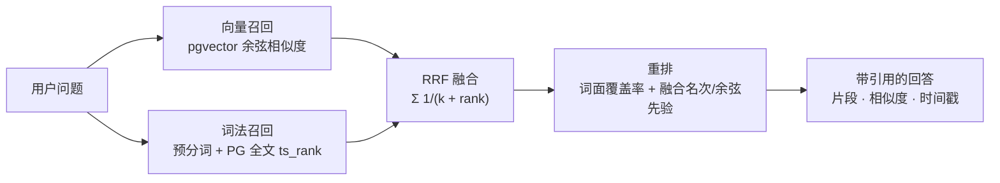

<div align="center">

# 知间 · KnowSpace

**本地优先的个人知识库** —— 资料入库、向量检索、带引用的问答，并把知识库通过 MCP 开放给外部 AI 工具。

[](https://github.com/1Oldcoin/KnowSpace/releases/tag/v1.0.3)
[](https://dotnet.microsoft.com/)
[](https://vuejs.org/)
[](https://www.electronjs.org/)
[](https://www.postgresql.org/)
[]()

</div>

> **命名说明**：产品名是**知间**，GitHub 仓库名是 **KnowSpace**，代码内部标识沿用 `MyFirstMafAgent`（程序集、exe、环境变量前缀 `MAF_`）。三者指同一个项目。

---

## 这是什么

把散落在硬盘里的学习资料（PDF、Word、Markdown、图片、音视频）收进一个本地知识库，自动解析、切分、向量化，然后用自然语言提问 —— 回答**带原文引用**，可以点回出处。

与「把文件丢给云端 AI」的关键区别：

- **数据在你手里**。原始文件存在本地磁盘，元数据/切片/向量存在随包分发的 PostgreSQL，不经过任何第三方存储。
- **回答可追溯**。每条结论都附引用片段与相似度，音视频引用能直接跳到「第几分几秒」。
- **能力可对外开放但受控**。外部 AI 工具通过 MCP 接入时，能精确限定「读哪些库、调哪些工具、每分钟几次」，并全量审计。

### 检索是怎么做的（混合 RAG）

问题不是「找相似的句子」，而是「既要看懂意思，也要一字不差地命中」。所以检索走的是**两路召回 → RRF 融合 → 重排 → 带引用生成**：



| 环节 | 实现 | 为什么这么选 |
| --- | --- | --- |
| **向量召回** | pgvector 的 `vector` 列 + 余弦距离，查询向量由进程内 BGE ONNX 模型（`bge-small-zh-v1.5`）或外部 embedding 接口生成 | 负责「意思相近」：换个说法、同义词、跨语言表述也能召回 |
| **词法召回** | 自研 CJK 分词写入 `kb_chunks.lexical_tokens`，PostgreSQL `to_tsvector('simple', …)` + GIN 表达式索引，按 `ts_rank` 排序 | 负责「字面必须出现」：产品编号、报错码、人名、罕见术语 —— 这些在向量空间里几乎不可分 |
| **融合（RRF）** | `score(d) = Σ 1 / (k + rank_i(d))`，默认 `k = 60`；同一片段被两路同时召回时只保留一条，并标记来源 | **不**把余弦和 `ts_rank` 加权相加：两者量纲完全不同（余弦 0–1，`ts_rank` 通常只有 0.0x），任何线性权重都得按语料重新调参；RRF 只看排名，天然免疫量纲问题 |
| **重排** | 在融合结果上叠加「词面覆盖率」，权重 `RerankLexicalWeight = 0.65`；送进重排的候选池默认 60 条 | RRF 只看名次不看内容，会把「词法排第 5、但正文确实完整回答了问题」的片段压在后面；放大候选池再重排才能把第 6 名救回来（实测 recall 0.9762 → 1.0000） |
| **拒答** | `AbstainEnabled` 默认**关闭**，靠提示词约束模型回答「资料里没有」 | 实测这份语料上重排分数不可分（有答案最低 0.361、无答案最高 0.474），硬上阈值要误拒 16/42 条有答案的资料，代价比让模型自己说「没有」高得多 |

所以「混合 RAG」在这里具体指：**向量 + 词法双路召回，用 RRF（Reciprocal Rank Fusion）融合成一个排名，再按词面覆盖率重排，最后把命中的原文片段连相似度一起交给模型作答**。

几个工程约束值得知道：

- **两路是串行执行的**，不是并发。同一个 `SqlSugarScope` 在一个请求上下文里共用一条连接，并发查询会抛 `NpgsqlOperationInProgressException`。
- **检索模式可显式指定**：`hybrid`（纯 RRF，评估基线）、`vector`、`lexical`、`rerank`（融合 + 重排）。显式传 `hybrid` 不会被配置偷偷升级成重排，否则评估基线会随线上配置漂移。
- **跨模型绝不复用向量**：每个索引绑定向量模型的指纹与维度，指纹不一致时直接报错，避免不同向量空间混用导致「看起来能搜、结果全错」。

## 功能一览

| 模块 | 能力 |
| --- | --- |
| **我的资料** | 上传 PDF / DOCX / TXT / MD / HTML / 常见图片 / 视频 / 音频（MP3、WAV、M4A、AAC、OGG、OPUS、FLAC、WEBA、AMR）；处理进度、摘要、失败原因；卡片直接显示图片缩略图、内联播放音频 |
| **多知识库** | 新建、切换、删除知识库（侧栏一键，删除会连同资料/切片/向量/笔记/专题/问答历史与磁盘文件一起清理）；默认知识库是「未指定知识库」的兜底目标，不可删除 |
| **AI 知识问答** | 混合检索（向量 + 词法，RRF 融合）+ 重排；带引用回答；工具增强模式（联网搜索、本地文件访问）；问答历史新建/重命名/批量删除/Markdown 导出 |
| **学习笔记** | 笔记 CRUD、置顶、按资料反查引用、导出；可从问答回答一键存为笔记 |
| **我的专题** | 按专题归类资料，侧栏与资料页联动筛选；删除专题只解除归属，不删资料 |
| **AI 伴侣** | 导入通用聊天记录（UTF-8 JSON/TXT），生成表达风格描述，基于历史样本独立对话 |
| **我的分身** | 投喂日记、聊天记录、性格与形象描述，提炼可复用人格洞察，用第一人称回答「如果是我会怎么做」 |
| **任务中心** | 长任务并发调度、类型配额、租约与重试、事件流 |
| **插件平台** | 独立子进程 + JSON-RPC over stdio；Windows AppContainer / Linux bubblewrap 真隔离；清单签名校验、权限授予、调用配额、审计 |
| **MCP** | 既是**服务端**（把知识库开放给 Cursor / Claude / 自研 Agent），也是**客户端**（让聊天模型调用外部 MCP 工具）。接入方（外部 Agent）在「设置 → 管理接入客户端」里新建、改能力与工具白名单、限定可见知识库、轮换密钥、看调用统计与审计，不需要 curl |

## 架构


**关键设计取舍**

- **后端是一体的**：API + 零部件 + Embedding 模型打成一个可分发单元（Windows 上含便携 PostgreSQL 与 ffmpeg；Linux 上这两个由系统包提供，见「方式三」）。装完即用，不需要用户自己装数据库。
- **Electron 只是壳**：只负责窗口、端口分配、令牌注入与子进程生命周期，不含业务逻辑。同一份后端可以跑成桌面版、控制台版或容器。后端丢失（崩溃 / 被安全软件结束）后会自动重连并把窗口接回新地址，不需要重启整个应用。
- **单一组合根**：桌面宿主与控制台宿主共用 `ApiHost.BuildAsync`，避免两套 HTTP 行为。
- **启动有指纹快路径**：数据库结构未变时跳过全部 DDL 与目录查询，后端就绪从 3.8–5.1s 降到 1.4s 左右。

## 快速开始

### 方式一：Windows 安装包（最省事）

从 [Releases](https://github.com/1Oldcoin/KnowSpace/releases) 下载 `Zhijian-x.y.z-setup.exe`（安装后显示为「知间-本地知识库」），双击安装。

- 装到 `%LOCALAPPDATA%\Programs\Zhijian`，每用户安装、不需要管理员
- 用户数据在 `%LOCALAPPDATA%\MyFirstMafAgentData`，卸载不会删除
- 首次启动会在后台初始化便携数据库（约 5–10 秒），之后约 1.5 秒

> 安装包目前**未做代码签名**，首次运行 Windows SmartScreen 会提示「未知发布者」，选择「更多信息 → 仍要运行」即可。

每个 Release 固定附三份产物，对三种部署形态：

| 产物 | 给谁 |
| --- | --- |
| `Zhijian-x.y.z-setup.exe` | Windows 桌面版（自带便携 PostgreSQL，双击即用） |
| `Zhijian-linux-x64-x.y.z.tar.gz` | Linux 裸机 / systemd（自包含，目标机不需要装 .NET） |
| `Zhijian-x.y.z-docker-context.tar.gz` | Docker（完整构建上下文，解压即 `docker compose up -d --build`，本机无需 .NET SDK / Node） |

`latest.yml` 与 `.blockmap` 只服务于 Electron 自动更新，手工部署不用管。

### 方式二：Docker（Linux 服务器，一体包）

```bash
# 取源码，两种都行：
#   ① 直接下载 Release 里的 Zhijian-x.y.z-docker-context.tar.gz 并解开（已剔除 Windows 专用二进制）
#   ② git clone https://github.com/1Oldcoin/KnowSpace.git && cd KnowSpace

cp .env.example .env      # 然后编辑：LLM_API_KEY（必填）/ MAF_SERVER_TOKEN（必填，否则拒绝启动）/ PG_PASSWORD / PUBLIC_BASE_URL
docker compose up -d --build   # 一个容器：API + 前端 + PostgreSQL 17 + pgvector
```

首启动要 `initdb` + 全量建表，约 30~90 秒（`docker compose logs -f app` 能看到进度）。

> ⚠️ **容器形态下浏览器界面不可用，这是有意的。** `/api` 由 `X-Api-Token` 保护，而前端代码
> 只会裸 `fetch`（令牌由 Electron 主进程注入，浏览器里没有）。所以容器版的实际用途是
> **跑 MCP 服务端 + 用 curl 管理**；拿 curl 建密钥、调工具见
> [`docs/MCP-ACCESS.md`](docs/MCP-ACCESS.md) §4.4。
>
> 一定要在浏览器里用界面，只有两条路：① 反向代理认证后注入 `X-Api-Token`
> （[`docs/CLOUD-DEPLOYMENT.md`](docs/CLOUD-DEPLOYMENT.md) §3.1 A）；
> ② SSH 隧道 + 桌面形态（同文档 §3.7.1）。

`LLM_API_KEY` **必须填**（DeepSeek 或任何 OpenAI 兼容端点）。留空时上传、切块、向量化都正常，只有问答与摘要会在调用时报 401 —— 启动日志里也会有一条 warning 直接点名缺哪个配置项。

两种形态，二选一：

| 命令 | 形态 | 说明 |
| --- | --- | --- |
| `docker compose up -d --build` | **一体（默认）** | API + 前端 + PG17 + pgvector 全在一个容器，数据在 `maf-app-data` 卷 |
| `docker compose --profile external up -d --build` | 外部库 | `api` + `db`（pgvector 镜像）两个容器，适合要独立备份/扩容的场景 |

镜像名是 `zhijian-api:integrated`；compose **项目名固定为 `zhijian`**（`docker-compose.yml` 顶部的 `name:`），所以卷叫 `zhijian_maf-app-data`，跟你 clone 到哪个目录无关。

> 从旧版本升级：如果之前的卷名是 `<目录名>_maf-app-data`，固定项目名后新卷是空的，数据看起来「丢了」。先备份再复制：
>
> ```bash
> docker volume create zhijian_maf-app-data
> docker run --rm -v <旧卷名>:/from -v zhijian_maf-app-data:/to alpine cp -av /from/. /to/
> ```

改回内部库 ⇄ 外部库不用重建镜像：只改 `PortablePostgres__Enabled` 与 `ConnectionStrings__KnowledgeBase` 两个环境变量。

自检（容器内或裸机都能跑，只依赖 curl）：

```bash
docker compose exec app bash /app/scripts/Test-IntegratedStack.sh --pg-password "$PG_PASSWORD"
```

> 默认只绑 `127.0.0.1`。**对外暴露前必读 [`docs/CLOUD-DEPLOYMENT.md`](docs/CLOUD-DEPLOYMENT.md)** —— 需要配反向代理与 TLS。
> 1.0.1 起，容器（`Hosting__Profile=Server`）缺 `MAF_SERVER_TOKEN` 会**直接拒绝启动**而不是静默不鉴权，`docker compose logs` 里会写明缺哪一项。

### 方式三：Linux 裸机（systemd，不用 Docker）

Linux 只有**一份**产物：一个自包含的 tar.gz（目标机不需要装 .NET），直接从
[Releases](https://github.com/1Oldcoin/KnowSpace/releases) 下载 `Zhijian-linux-x64-x.y.z.tar.gz` 即可，
不需要自己打包。

```bash
scp Zhijian-linux-x64-1.0.3.tar.gz user@host:/tmp/
ssh user@host
tar xzf /tmp/Zhijian-linux-x64-1.0.3.tar.gz -C /tmp/
sudo bash /tmp/Zhijian-linux-x64/deploy/linux/install.sh --source /tmp/Zhijian-linux-x64/app
```

装到 `/opt/myfirstmafagent`，数据在 `/var/lib/myfirstmafagent`，配置在 `/etc/myfirstmafagent/myfirstmafagent.env`。
`deploy/linux/README-LINUX.md` 是完整说明书（含「这台机器上没验证过」清单）。

<details>
<summary>想自己从源码重打包（需要 .NET 10 SDK + Node 22）</summary>

```powershell
.\scripts\Publish-Portable.ps1 -Target console -Runtime linux-x64
# 产物：publish\console-linux-x64\（约 310 MB，扁平结构）
```

发布包额外把 `deploy/linux/` 与 `scripts/Test-IntegratedStack.sh` 收进去、并把后端放进 `app/`
子目录，所以两种目录布局的 `--source` 不同：直接拷 `console-linux-x64` 时用
`--source /tmp/console-linux-x64`，用 Release 包时用 `--source /tmp/Zhijian-linux-x64/app`。

</details>

> **Linux 只有这一份产物**：前端是 `wwwroot/` 里的静态文件，由 API 自己托管，不存在「有 UI 版 / 无 UI 版」的区分。
> Electron 壳只服务 Windows 安装包。
>
> 但**裸机上浏览器打不开可用界面**：`install.sh` 写入的 env 里有 `MAF_SERVER_TOKEN`，`/api` 因此要求
> `X-Api-Token`，而浏览器里没人注入它。日常用 curl 管理（见 `docs/MCP-ACCESS.md` §4.4），
> 或按 `docs/CLOUD-DEPLOYMENT.md` §3.7.1 用 SSH 隧道 + Desktop 形态把界面接到本机。

两件必须知道的事：

1. **包里不带 pgSQL / ffmpeg 二进制**（只有占位 README）。`install.sh` 会用 apt 装 `postgresql-17` +
   `postgresql-17-pgvector`，并把 `PortablePostgres__BinDirectory` 指到 `/usr/lib/postgresql/17/bin`。
   原因是 Linux 的 PostgreSQL 二进制与发行版 ABI 绑定（libicu / libssl 的 soname 各不相同），
   而且官方发布的二进制**不含 pgvector** —— 拷一棵树过去反而启动失败。
2. **不跑 `install.sh` 而直接 `./Zhijian.Api` 会启动失败**：便携库目录是空的，
   `PortablePostgresHost` 找不到 `postgres` 二进制就会抛 `FileNotFoundException`。
   手工跑至少要给这两个环境变量：

   ```bash
   export PortablePostgres__BinDirectory=/usr/lib/postgresql/17/bin
   export PortablePostgres__RootDirectory=/var/lib/myfirstmafagent
   ./Zhijian.Api --urls http://127.0.0.1:5056
   ```

   或者干脆关掉内置库、改用外部 PostgreSQL（`PortablePostgres__Enabled=false` + `ConnectionStrings__KnowledgeBase`）。

### 方式四：从源码开发

前置：**.NET 10 SDK**、**Node.js 22.18+ 或 24.12+**

```bash
# 后端（首次会自动 initdb 便携数据库）
dotnet run --project MyFirstMafAgent.Api
# → http://127.0.0.1:5056

# 前端热重载（另开一个终端）
cd FrontEnd/myfist-agent
npm install
npm run dev
# → http://localhost:5173（已加入 CORS 白名单）
```

构建前端并交给后端托管：

```bash
cd FrontEnd/myfist-agent && npm run build
# 把 dist/{index.html,assets} 复制到 MyFirstMafAgent.Api/wwwroot
```

桌面壳：

```bash
cd desktop-electron
npm install
npm start          # 开发运行
npm run dist:full  # 打包 NSIS 安装包
```

**原生工具**：`MyFirstMafAgent.Api/ExternalTools/` 下的 ffmpeg / Embedding 模型 / 便携 PostgreSQL 现在**随仓库分发**，克隆下来即可用：

- `ExternalTools/Embedding/`（bge-small-zh-v1.5，约 90 MB）与 `ExternalTools/pgSQL/`（便携 PostgreSQL，约 65 MB）是普通 git 对象，clone 即得。
- `ExternalTools/ffmpeg/` 三个 exe（ffmpeg / ffplay / ffprobe，各约 100 MB）超过 GitHub 单文件 100 MiB 上限，**走 Git LFS**。

因此克隆前先装 git-lfs，否则那三个 exe 只会是几十字节的指针文件：

```bash
winget install GitHub.GitLFS
git lfs install
git clone https://github.com/1Oldcoin/KnowSpace.git
```

已经克隆但漏了 LFS 的话，进仓库执行 `git lfs pull` 即可补回。只想补 ffmpeg，也可以继续用装配脚本：

```powershell
powershell -ExecutionPolicy Bypass -File scripts\Download-ExternalTools.ps1 -Target ffmpeg
```

缺了会怎样，两种情况不一样：

- **ffmpeg 缺失**：只是视频/音频解析不可用，日志里有可读错误，其余功能正常（Linux 上由 apt 提供，`Dockerfile` 也会删掉随包副本改用 apt 的）。
- **便携 PostgreSQL 缺失**：**启动会失败** 并抛 `FileNotFoundException`（`PortablePostgresHost` 找不到 `postgres` 二进制）。此时要么补回 `ExternalTools/pgSQL/<rid>/` 整棵树，要么配 `PortablePostgres__BinDirectory` 指向系统安装的 `bin`，要么关掉内置库改用外部连接串（`PortablePostgres__Enabled=false`）。

> **运行时数据不入库**：`App_Data/pgdata`（数据库文件）与 `App_Data/uploads`（上传的资料）都不在版本库里 —— 跑一次开发环境就会产生上百个二进制变更，而且 `pgdata` 与 PostgreSQL 大版本绑死（PG18 打不开 PG17 的数据目录）。**首次启动会自动 `initdb` + 全量建表**，clone 下来直接 `dotnet run` 就是一个干净的库，不需要靠提交数据库来做到「开箱即用」。`.gitattributes` 仍把 `App_Data/` 与 `ExternalTools/` 标成 `-text`，防止本机 `core.autocrlf=true` 改写二进制。

## 把知识库接给外部 AI（MCP）

三步。先在应用内「设置 → AI 工具与 MCP → 管理接入客户端」建一个密钥（明文只显示一次），
或直接在左侧导航「接入的 AI 工具」里更精细地设能力 / 工具白名单 / 可见知识库：

```jsonc
// Cursor: ~/.cursor/mcp.json
{
  "mcpServers": {
    "knowspace": {
      "url": "https://knowspace.example.com/mcp",   // 本机则 http://127.0.0.1:5056/mcp
      "headers": { "X-Api-Key": "maf_xxxxxxxxxxxxxxxx" }
    }
  }
}
```

```bash
# 或者直接 JSON-RPC
curl -X POST http://127.0.0.1:5056/mcp \
  -H "Content-Type: application/json" \
  -H "X-Api-Key: maf_xxxxxxxxxxxxxxxx" \
  -d '{"jsonrpc":"2.0","id":1,"method":"tools/list"}'
```

**授权模型**是三级收窄：

```
能力（knowledge:read / knowledge:write / workspace:* / files:* / avatar:* / chat:read）
  └→ 工具白名单（可选，进一步限定到具体工具名）
      └→ 知识库白名单（可选，限定能操作哪些库）
```

再加逐客户端令牌桶限流、按 IP 的鉴权失败封禁、全量调用审计。
**清单外的工具默认拒绝** —— 新增工具忘了登记是「不可用」，不是「对所有人开放」。

完整说明：[`docs/MCP-ACCESS.md`](docs/MCP-ACCESS.md)（速查）· [`docs/MCP-INTEGRATION-MANUAL.md`](docs/MCP-INTEGRATION-MANUAL.md)（整合版）

## 桌面版自动更新

安装包内 `resources/app-update.yml` 指向本仓库的 GitHub Releases（`electron-builder.yml` 的 `publish: provider: github`）。发新版的完整流程：

```powershell
# 1. 改 desktop-electron\package.json 的 version（例如 1.0.4）
# 2. 打包（默认在 %TEMP% 构建再拷回 publish\releases，见脚本注释）
powershell -ExecutionPolicy Bypass -File scripts\Build-ElectronInstaller.ps1
# 3. 建 GitHub Release 并上传 latest.yml + 安装包 + blockmap
powershell -ExecutionPolicy Bypass -File scripts\Publish-Release.ps1 -Version 1.0.4
```

客户端启动 20 秒后自动查一次，之后每 6 小时复查；也可在「设置 → 关于/更新」或菜单「帮助 → 检查更新」手动触发。
更新源可覆盖（优先级从高到低）：环境变量 `MAF_UPDATE_URL` → 用户数据目录下的 `update-feed.json`（`{"url":"..."}`）→ 安装包内置的 GitHub 地址。

> **国内网络注意**：`github.com` 在部分网络下不可直连（表现为 `net::ERR_CONNECTION_TIMED_OUT`）。
> 这时可以让客户端走代理启动：`MyFirstMafAgent.exe --proxy-server=http://127.0.0.1:7897`，
> 或者用 `MAF_UPDATE_URL` 指向任意可访问的静态目录（generic 源，放 latest.yml + 安装包即可）。
> 注意 `api.github.com` 通常可直连，被墙的是 `github.com` 主站与 raw 域名——所以「能 push 不能更新」是正常现象。

## 版本与分支

当前发布版本：**1.0.3**（Windows 安装包 / Linux 包 / Docker 镜像均来自同一份代码）。

| 分支 | 定位 | 规则 |
| --- | --- | --- |
| `main` | **稳定分支**，只放已验证可发布的代码 | 不直接提交；只接受从 `dev` 合并 |
| `dev` | **开发分支**，日常改动都落在这里 | 所有提交先推这里，手工验证通过后再合并到 `main` |

> 本地仓库的 `master` 跟踪远端的 `main`（历史原因），命令里用 `master:main` 显式指定推送目标。

```bash
# 日常：改完推到 dev
git checkout dev
git add -A && git commit -m "feat: ..."
git push github dev

# 验证没问题后，合并到 main
git checkout master
git merge --no-ff dev
git push github master:main
```

分支名对不上、命令要记两套，容易敲错（`git push github master` 会凭空在远端多出一个 `master` 分支）。所以整套动作收进了脚本：

```powershell
# 先看一眼会做什么（只读，不改任何东西）
powershell -ExecutionPolicy Bypass -File scripts\Merge-To-Main.ps1 -DryRun

# 一键合并 dev -> main 并推送
powershell -ExecutionPolicy Bypass -File scripts\Merge-To-Main.ps1

# 顺带重打版本标签
powershell -ExecutionPolicy Bypass -File scripts\Merge-To-Main.ps1 -TagName v1.0.4
```

脚本做的事：检查工作区干净 → `fetch` → 本地 `master` 快进到 `github/main` → `merge --no-ff dev` → 推送 `master:main` → 把 `dev` 也指到合并提交并推送（避免下次出现「假落后」）→ 可选重打标签。默认会列出待合并的提交并要求确认，`-Yes` 跳过；`-NoPush` 只做本地合并；本地 `master` 有未推送提交时默认拒绝继续。

### 1.0.3 更新要点

这一版的主题是**"桌面端不再需要手动重启"**，外加补齐 MCP 接入的缺口。

| 项 | 变化 |
| --- | --- |
| **后端自动重连** | 新增 15 秒存活看护。后端崩溃、被安全软件结束、或换了端口之后，窗口会**自动接回新地址**并刷新，不再表现为「挂一阵子就用不了」。恢复失败 5 次才弹框 | |
| **专属端口** | 桌面版默认监听 **5056**（`Server:FixedLocalPort`），不再每次启动随机，手写的 MCP 配置可以长期有效；**端口被占用时自动回退随机端口**，不会起不来。设 `0` 恢复随机，或用环境变量 `MAF_FIXED_LOCAL_PORT` 覆盖 |
| **接入客户端管理页** | 新增「接入的 AI 工具」页（设置页有入口）：新建客户端、勾能力与工具白名单、限定可见知识库、轮换密钥、看调用统计与审计明细。同时新增 `GET /api/agent-clients/overview` 聚合接口 |
| **删除知识库** | 侧栏知识库右侧新增删除按钮，会连同资料、切片、向量、笔记、专题、问答历史与磁盘文件一起清理；默认知识库不可删 |
| **安装包瘦身** | 283 → 278 MB：不再把构建机上跑过的 PostgreSQL 数据目录打进安装包 |

关于「统计当前被连接的应用」：MCP 是**无状态** Streamable HTTP，服务端没有长连接可查，
所以页面上的口径是「**最近活跃**」= 已启用且最近 5 分钟内有有效调用，不写成「已连接」。

### 1.0.1 更新要点

这一版的主题是**"部署到公网也不至于裸奔"**：把桌面形态下"本机即可信"的假设，从服务端形态里彻底剥掉。

| 项 | 变化 |
| --- | --- |
| **新增宿主形态** | `Hosting:Profile = Auto / Desktop / Server`。容器与 systemd 显式 `Server`；`Auto` 只要监听非回环地址就按服务端处理 |
| **启动守卫** | 服务端形态下缺 `MAF_SERVER_TOKEN`（或短于 32 字符）、`Mcp:RequireClientKey=false`、CIMD 调试开关、OAuth Issuer 非 https → **拒绝启动并打印中文原因**，不再带着漏洞跑起来 |
| **`/mcp` 传输收紧** | 非 JSON → 415、超大 → 413、JSON 解析失败或含重复属性名 → 400、**JSON-RPC 批量请求一律拒绝**；`server/discover` 仅单条消息免认证 |
| **DNS rebinding 防护** | `/mcp` 校验 `Host` 与 `Origin`（回环名、`Mcp:OAuth:Issuer`、`Server:PublicBaseUrl` 自动加入白名单，其余 403） |
| **同意页加闸门** | `/oauth/authorize` 的 GET 与 POST 只接受本机来源或带有效 `X-Api-Token` 的请求，堵住"公网自助发令牌" |
| **聊天历史范围** | 配了知识库白名单的客户端不再能读到其他知识库的问答、也读不到分身/伴侣对话（应用层 + SQL 双层收窄） |
| **云端不暴露本机文件** | 服务端形态不注册 `local_*` 工具 —— 云上的"本机目录"是服务器的文件系统 |
| **依赖 CVE** | 顶层钉 `System.Security.Cryptography.Pkcs 10.0.14`，消掉 SqlSugarCore 带进来的 2 条公告；新增 `scripts/Check-Dependencies.ps1` 门禁 |
| **安装包瘦身** | 283 MB（上一版 297 MB） |

桌面版当时行为不变：回环随机端口 + 一次性令牌 + 便携数据库（端口已在 1.0.3 改为默认固定 5056，并加了自动重连）。完整设计、迁移路径与后续阶段见
[`docs/MCP-REMOTE-DESIGN.md`](docs/MCP-REMOTE-DESIGN.md)。

## 文档

| 文档 | 内容 |
| --- | --- |
| [`ARCHITECTURE.md`](ARCHITECTURE.md) | 系统架构、模块划分、关键设计决策与踩过的坑（**改动前先读**） |
| [`PROJECT_DOCUMENTATION.md`](PROJECT_DOCUMENTATION.md) | 已实现功能的代码落点索引，按文件逐个说明职责 |
| [`docs/ROADMAP.md`](docs/ROADMAP.md) | 技术债、待做功能、明确不做的事（留档避免反复讨论） |
| [`docs/DEPLOYMENT.md`](docs/DEPLOYMENT.md) | 跨平台部署口径：三种交付形态、平台矩阵、原生工具解析规则 |
| [`docs/CLOUD-DEPLOYMENT.md`](docs/CLOUD-DEPLOYMENT.md) | **云服务器部署与 MCP 接入**：安全清单、Docker/systemd/Windows 三种形态、密钥生命周期 |
| [`docs/MCP-REMOTE-DESIGN.md`](docs/MCP-REMOTE-DESIGN.md) | **远程 MCP 与云端安全设计**：Desktop/Server 双形态、启动守卫、`maf_`→`zjp_` 迁移路径、审计保留与分区、备份恢复、日志脱敏、多副本限流 |
| [`docs/archive/DOCKER-VERIFICATION-2026-10-27.md`](docs/archive/DOCKER-VERIFICATION-2026-10-27.md) | 一次真实 Docker 环境验收的完整记录（历史存档，已脱敏） |
| [`docs/MCP-ACCESS.md`](docs/MCP-ACCESS.md) | MCP 接入速查：三步接入、能力词表、排错 |
| [`docs/MCP-INTEGRATION-MANUAL.md`](docs/MCP-INTEGRATION-MANUAL.md) | MCP 两个方向（服务端 / 客户端）的完整说明书 |
| [`docs/JOBS.md`](docs/JOBS.md) | 任务中心：并发、配额、租约、重试与事件流 |
| [`docs/PLUGIN-DEVELOPER-MANUAL.md`](docs/PLUGIN-DEVELOPER-MANUAL.md) | 插件开发说明书：15 分钟上手、manifest 字段、能力、打包发布 |
| [`docs/PLUGIN-LIFECYCLE.md`](docs/PLUGIN-LIFECYCLE.md) | 插件生命周期与安全口径（核心侧如何校验、隔离、审计） |
| [`docs/PHASE0-BASELINE.md`](docs/PHASE0-BASELINE.md) | 阶段 0 的延迟/索引基线（历史存档） |
| [`desktop-electron/README.md`](desktop-electron/README.md) | 桌面壳：启动/退出时序、启动画面定制、自动更新 |

## 仓库结构

```
MyFirstMafAgent.Api/          ASP.NET Core 后端（组合根 ApiHost + Hosting/ 模块化注册）
  Hosting/                    启动顺序、中间件管线、数据库初始化、MCP 准入闸门、安全
  Domain/                     领域模型与纯函数策略（可脱库穷举测试）
  Application/                用例层（客户端管理、检索路由、索引生命周期…）
  Endpoints/                  REST 端点（Minimal API）
  Mcp/                        MCP 工具实现（知识库 / 文件 / 分身 / 聊天历史）
  Plugins/                    插件运行时与隔离
  Infrastructure/             SqlSugar 持久化、便携 PostgreSQL、Embedding、日志
  ExternalTools/              原生二进制（不入库，按需装配）
MyFirstMafAgent.Api.Tests/    xUnit 测试
MyFirstMafAgent.Plugins.Sdk/  插件 SDK（第三方插件引用）
FrontEnd/myfist-agent/        Vue 3 + TS + Vite 前端
desktop-electron/             Electron 主进程与打包配置
scripts/                      发布、测量、E2E 验证脚本
samples/                      示例插件
docs/                         文档
```

## 安全模型

| 面 | 使用者 | 凭据 | 说明 |
| --- | --- | --- | --- |
| `/api` | 界面 | `X-Api-Token` | 桌面：每次启动重新生成、不落盘；服务端：长期令牌或反向代理注入 |
| `/mcp` | 外部 Agent | `X-Api-Key` / `Bearer` | 长期密钥，只存 SHA-256 哈希 + 前缀，明文仅创建时出现一次 |
| 静态资源 | 浏览器 | 无 | 首页与 `assets/*` |

其它已实现项：插件真隔离（AppContainer / bubblewrap）+ 清单签名校验、SSRF 防护（含云元数据地址段）、
`/api/desktop/*` 回环限制、全局安全响应头、`Server` 头隐藏、请求体上限。

细节与部署清单见 [`docs/CLOUD-DEPLOYMENT.md`](docs/CLOUD-DEPLOYMENT.md)。

## 当前状态

项目处于**自用演进**阶段：功能完整可用，接口与配置项仍可能调整。

- ✅ 已完成：知识库全链路、多知识库与删除、混合检索、MCP 双向（含接入客户端管理页）、
  插件平台、桌面安装包 + 自动更新发布链路、Linux 包、Docker 部署
- ⚠️ 已知限制：
  - 安装包**未做代码签名**，首次运行会触发 SmartScreen 提示
  - **单用户**：没有账号体系，管理面靠一次性令牌 / 长期令牌
  - MCP 密钥**无有效期字段**，目前只能靠手动轮换
  - **Linux / Docker 形态没有可用的浏览器界面**（`/api` 要 `X-Api-Token`，浏览器里没有注入点），
    只能 curl 管理或按 `docs/CLOUD-DEPLOYMENT.md` §3.1/§3.7 自行接界面
  - 云端**只支持单副本**（限流与诊断都在进程内）

详见 [`docs/ROADMAP.md`](docs/ROADMAP.md)。

## 许可

本仓库暂未附带开源许可文件。**在补充 LICENSE 之前，默认保留所有权利** ——
如需引用或二次分发，请先通过 Issue 联系作者。
