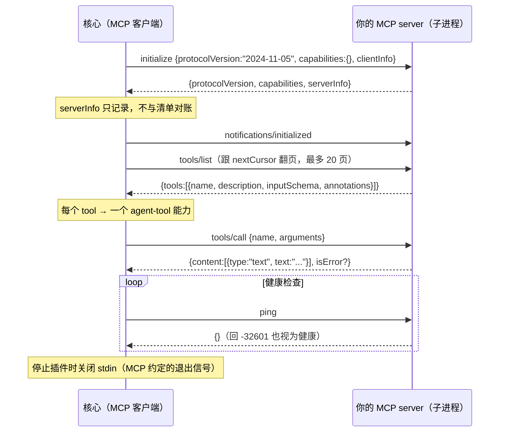

# MCP 接入说明书

> 本应用与 MCP 有**两个相反方向**，先分清你在哪一边，再看对应章节。

| 方向 | 你是谁 | 想要什么 | 看 |
| --- | --- | --- | --- |
| **A1. 内置 MCP 客户端** | 你自己 / 运维 | 在配置文件里挂一个外部 MCP server（支持 HTTP） | §1.0 |
| **A2. 接入现成 MCP server 作为插件** | 插件作者 / 用户 | 把别人写好的 stdio MCP server 变成应用里的工具 | §1.1–§1.11 |
| **B. 把本应用当 MCP server** | 外部 Agent 的开发者 | 让 Cursor / Claude Desktop / 自研 Agent 调用本应用的知识库、文件、聊天记录 | §2 |

两者**机制完全不同**：A 是核心当 MCP 客户端（或插件宿主），B 是核心当 MCP 服务端；凭据、权限、配置全不同。

- 想写一个**自有协议**的插件（配置下发、健康检查、平台连接器）：见 `docs/PLUGIN-DEVELOPER-MANUAL.md`。
- 想搞清楚插件运行时怎么管你：见 `docs/PLUGIN-LIFECYCLE.md`。

---

# 1. 方向 A：把现成 MCP server 接入进来

## 1.0 先选路线：内置 MCP 客户端 vs MCP 插件

接入外部 MCP server 有**两条互不相干**的路：

| | 内置 MCP 客户端（配置文件） | MCP 方言插件（本节主线） |
| --- | --- | --- |
| 怎么配 | `appsettings.json` 的 `Mcp:Servers` | 一个插件目录 + 清单 + 安装/重扫描 |
| 传输 | **Streamable HTTP** 与 **stdio** | **仅 stdio** |
| 进程 | stdio 时由核心拉起（与核心同权限，**无沙箱**） | 独立子进程，Windows 上跑在 AppContainer |
| 权限 | 无声明/授权机制 | 声明 ∩ 授权，权限不足可拒绝启动 |
| 安装/升级/回滚 | 改配置 + **重启 API** | 不重启，支持 ZIP 安装、排空升级、回滚 |
| 审计 | 无 | 有（`plugin_audit_events`） |
| 工具名 | `mcp__{server}__{tool}` | `plugin__{id}__{tool}` |
| 发给模型 | 受 `Agent:EnableMcpToolBridge` 控制 | 受 `sideEffect` 与 `Plugins:EnableToolBridge` 控制 |
| 看状态 | `GET /api/mcp/status` | `GET /api/plugins/{id}` |
| 适合 | 你自己临时接一个内部 server、或必须用远程 HTTP MCP | 要发给别人用、要隔离与权限 |

内置客户端的最小配置（改完**必须重启 API**）：

```json
"Mcp": {
  "EnableClient": true,
  "Servers": [
    {
      "Name": "filesystem",
      "Transport": "stdio",
      "Command": "npx",
      "Arguments": ["-y", "@modelcontextprotocol/server-filesystem", "C:/work/docs"],
      "Enabled": true,
      "TimeoutSeconds": 60
    },
    {
      "Name": "remote-knowledge",
      "Transport": "http",
      "Endpoint": "http://127.0.0.1:9000/mcp",
      "Headers": { "Authorization": "Bearer <token>" },
      "Enabled": true
    }
  ]
}
```

```powershell
Invoke-RestMethod http://127.0.0.1:5056/api/mcp/status    # 逐个 server 的连接状态 + 工具数
```

> 内置客户端跑在**核心进程权限**下，没有权限闸门也没有审计。
> 要把一个 MCP server 当成“可发布、可治理”的扩展，请走下面的插件路线。

以下 §1.1–§1.11 全部指**插件路线**。

## 1.1 一句话结论

**已经写好的 stdio MCP server，加一份十几行清单就能载入，不用改它的代码。**

```bash
# 你本来会这么跑它
npx -y @modelcontextprotocol/server-filesystem /data
```

把它变成插件，只需要一个 `plugin.json`：

```json
{
  "schemaVersion": "1.0",
  "id": "filesystem",
  "name": "文件系统",
  "version": "1.0.0",
  "dialect": "mcp",
  "entry": {
    "command": "npx",
    "args": ["-y", "@modelcontextprotocol/server-filesystem", "/data"]
  },
  "protocol": { "minVersion": "1.0.0", "maxVersion": "1.0.999" }
}
```

放进 `App_Data/plugins/filesystem/`，点 **重新扫描**，它就 `Running` 了。
能力（工具）由核心在握手后通过 `tools/list` **自动发现**，清单里不用写 `capabilities`。

## 1.2 前提：传输方式必须是 stdio

| MCP 传输 | 插件路线 | 内置客户端 |
| --- | --- | --- |
| **stdio**（子进程 + stdin/stdout） | ✅ | ✅ |
| **Streamable HTTP**（远程 URL） | ❌ | ✅（见 §1.0） |
| 旧版 SSE | ❌ | ❌ |

插件是子进程，所以核心不会去连远程 MCP 端点。只用 HTTP 的 server 想以插件方式接入，两个办法：

1. 用 `mcp-remote` 之类的 stdio↔HTTP 桥接包把它包成子进程；
2. 在插件里自己实现一个极薄的 stdio 代理（转发 `initialize` / `tools/list` / `tools/call` 即可）。

或者干脆走 §1.0 的内置客户端（它原生支持 Streamable HTTP）。

## 1.3 清单怎么写

### 最小清单

```json
{
  "schemaVersion": "1.0",
  "id": "demo-mcp",
  "name": "演示 MCP",
  "version": "0.4.2",
  "dialect": "mcp",
  "entry": { "command": "node", "args": ["server.js"] }
}
```

MCP 方言下这几个字段可以省，核心会补默认值并给一条 warning（不会静默）：

| 缺什么 | 默认 | 告警 |
| --- | --- | --- |
| `name` | 用 `id` | 有 |
| `id` | 按 `name` 推导成 slug | 有 |
| `version` | `0.0.0` | 有 |
| `publisher` | `unknown` | 有 |
| `protocol` | `{minVersion:"1.0.0", maxVersion:"1.0.0"}` | 用 `"protocol": "mcp"` 写法时才提示 |
| `capabilities` | 来自 `tools/list` | 无 |

但 `id` 与 `entry.command` 是硬要求；`schemaVersion` 写了就必须是 `1.0`。

### 与自有协议插件的差别

| 字段 | 自有协议 | MCP 方言 |
| --- | --- | --- |
| `capabilities` | **至少 1 项**，必须写全 | 可为空 / 省略（来自 `tools/list`） |
| `protocol` | 闭区间必须包含 `1.0.0` | **不做区间校验**（版本由 MCP 自己协商） |
| `id` | 小写反向域名，段内 `a-z0-9-` | 放宽为单段，允许 `a-z0-9._-`（如 `demo-mcp`） |
| `parameters` | 你写 JSON Schema | 来自工具自身的 `inputSchema` |
| 配置下发 | `plugin/configure` | 环境变量（见 §1.7） |
| 版本对账 | 运行期自述必须与清单一致 | 不对账（`serverInfo` 只记录，见 §1.5） |
| 身份字段 | `name`/`version`/`publisher` 必填 | 缺失自动补默认值 + warning |

### `dialect` 的三种写法

```json
{ "dialect": "mcp" }
{ "protocol": "mcp" }
{ "protocol": { "dialect": "mcp" } }
```

三种都认。第二种最容易踩坑：`"protocol": "mcp"` 是**字符串**，声明的是方言而不是版本区间，核心会补默认协议区间并给一条 warning。

### `entry` 的写法

```json
{ "entry": { "command": "npx", "args": ["-y", "@scope/server"] } }
{ "entry": { "command": ["npx", "-y", "@scope/server"] } }
{ "entry": { "command": "node", "args": ["C:/plugins/mine/server.js"], "workingDirectory": "C:/plugins/mine" } }
{ "entry": { "command": "python", "args": ["-m", "my_mcp_server"], "env": { "API_KEY": "..." } } }
```

`command` 写成数组（Claude Desktop 的 `mcpServers` 风格）也认；`args` 是 `arguments` 的别名，`cwd` 是 `workingDirectory` 的别名。

## 1.4 权限：MCP 清单里没有，你必须补

MCP 自己没有权限概念。不补的后果很直接：

- 插件能跑，但**没有网络**（Windows AppContainer 默认 offline，`socket()` 直接 `EACCES`）
- 需要写文件的能力会失败（只能写 `MYFIRSTMAFAGENT_PLUGIN_DATA`）

```json
{
  "id": "demo-mcp",
  "dialect": "mcp",
  "permissions": ["network", "file-read"],
  "entry": { "command": "npx", "args": ["-y", "@scope/server"] }
}
```

顶层 `permissions` 对**所有**工具生效。也可以给单个工具单独声明或覆盖：

```json
{
  "dialect": "mcp",
  "capabilities": [
    { "id": "echo", "kind": "agent-tool", "sideEffect": "read" },
    { "id": "wipe-storage", "kind": "agent-tool", "sideEffect": "destructive", "permissions": ["file-write"] }
  ]
}
```

清单里写同名能力时，**会覆盖**该工具从 MCP `annotations` 推断出的等级。典型用途：把一个 MCP 标成 `readOnly` 的工具改成 `write-external` 以强制人工确认。

> ⚠️ **`capabilities` 是覆盖表，不是白名单。** 写了同名工具的 `sideEffect` / `permissions` / `parameters`，就**完全取代**推断值与顶层 `permissions`（不会合并）；没写的工具照常被 `tools/list` 发现。所以覆盖副作用等级时，记得把权限一并写上，否则那个工具会变成"零权限"。

**建议做法**：首跑先不写权限，看它失败在哪，再按需补。声明了 `network` 的插件会停在 `PermissionRequired`，需要用户授权后才启动。

权限词与别名（`fs`、`net.outbound`、`exec` 等）见 `docs/PLUGIN-AUTHOR-GUIDE.md` §3.1。

## 1.5 核心怎么驱动它（握手全流程）



要点：

1. **必须响应 `initialize`**，`protocolVersion` 建议回 `2024-11-05`。
2. **必须接受 `notifications/initialized`**（无 id，不回响应）。少发这条会导致部分 server 拒绝后续请求。
3. `tools/list` 要支持 `cursor` 分页；核心最多翻 20 页。
4. `tools/call` 的返回值会被**压平成一段文本**：
   - `content[].type == "text"` → 文本按行拼接；
   - `resource` 块 → 一行 `[resource] <uri>`；其它类型 → 一行 `[image]` / `[<type>]` 占位符；
   - `structuredContent` → 追加为一行 JSON；
   - 两者都没有 → 退回整个响应的原始 JSON；
   - 总长超过 32000 字符会被截断并标注。

   模型拿到的是**字符串**，不是结构化 JSON——想让它好读就把文本写得紧凑清楚。
5. `isError: true` 转成一次调用失败（内部错误码 `-32603`），文本作为错误信息。
6. 健康检查用 `ping`；**对端回 `-32601`（方法不存在）也视为健康**，所以老 server 不必实现它。
7. 停止插件时核心**关闭 stdin**，不发 `shutdown` 请求 —— 你的 server 读到 EOF 后自行退出。
8. 取消用 `notifications/cancelled {requestId, reason}`。

工具的能力名会被规范化（非 ASCII / 特殊字符转 `-`），最终暴露给模型的名字形如 `plugin__demo-mcp__echo`。

## 1.6 副作用等级怎么判定

核心从 MCP 的 `annotations` 推断：

| MCP 注解 | 判定结果 | 模型可见 |
| --- | --- | --- |
| `destructiveHint: true` | `destructive` | ❌ |
| `readOnlyHint: false` | `write-local` | ✅ |
| 其它（含没有 annotations） | `read` | ✅ |

`destructive` / `write-external` 的能力**永远不会**出现在 `/api/agent/tools`（模型无法提供人工确认）。要调用必须经管理端点并带 `"confirm": true`。

注意 `annotations` 只是**提示**，不是保证：没写 `readOnlyHint` 就被当成 `read` 处理（偏乐观）。
如果你的工具实际会写远端数据，**必须在清单里显式把 `sideEffect` 覆盖成 `write-external`**，否则模型会以为它只是只读而放心调用。

## 1.7 配置怎么下发

MCP 没有 `configure` 方法，所以配置走**环境变量**：

| 来源 | 注入的变量 |
| --- | --- |
| 清单 `entry.env` 的键值 | 原样注入 |
| 用户在界面填的配置，每个**标量**字段 | `MYFIRSTMAFAGENT_CONFIG_<KEY大写>` |

例如用户配置 `{"apiKey":"abc","region":"cn"}` → `MYFIRSTMAFAGENT_CONFIG_APIKEY=abc`、`MYFIRSTMAFAGENT_CONFIG_REGION=cn`。

- 改配置会**重启插件进程**（新环境变量只能这样生效）。
- 清单可以写 `config.schema`，界面会据此生成表单；`config.required` 没填时插件停在 `NeedsConfiguration`。
- 非标量（对象/数组）字段不会被注入，请让用户用 `entry.env` 或字符串化字段。

## 1.8 装进去

### 目录方式（最快）

```
App_Data/plugins/demo-mcp/
  plugin.json            ← 或 manifest.json / skill.json
  server.js
  package.json
  node_modules/…          ← 依赖必须在包内，沙箱里不能临时 npm install
```

然后 `POST /api/plugins/rescan`（界面「重新扫描」）。

### ZIP 方式

```powershell
$src = 'App_Data\plugins\demo-mcp'
$zip = 'C:\Temp\demo-mcp.zip'
if (Test-Path $zip) { Remove-Item $zip }
Compress-Archive -Path "$src\*" -DestinationPath $zip
curl.exe -s -F "file=@$zip" http://127.0.0.1:5056/api/plugins/install
```

### 验证

```powershell
$b = 'http://127.0.0.1:5056'
curl.exe -s "$b/api/plugins/demo-mcp"
curl.exe -s "$b/api/agent/tools"      # 确认 plugin__demo-mcp__* 已出现
```

成功标志（`GET /api/plugins/demo-mcp` 的关键字段）：

```json
{
  "dialect": "mcp",
  "isolation": "appcontainer:network",
  "status": { "state": "Running", "health": "healthy" },
  "capabilities": ["echo", "wipe-storage"],
  "discoveredCapabilities": [
    { "id": "echo", "kind": "agent-tool", "sideEffect": "read", "permissions": [] }
  ]
}
```

字段区别：

| 字段 | 类型 | 含义 |
| --- | --- | --- |
| `capabilities` | 字符串数组 | **运行期真正生效**的能力 id（最常用的那个） |
| `discoveredCapabilities` | 对象数组 | 同上，但带 `kind` / `sideEffect` / `permissions` / `parameters` 详情 |
| `declaredCapabilities` | 对象数组 | 清单里写的（MCP 方言下可能为空） |

日志里应出现：

```
MCP server demo-mcp introduced itself as 'demo-mcp-server' 0.4.2 (protocol 2024-11-05)
ready with 2 capability(ies): echo, wipe-storage
```

> `discoveredCapabilities` 是**运行期发现**的，`declaredCapabilities` 是清单里写的。MCP 方言下看前者。

调一次：

```powershell
Invoke-RestMethod -Method Post -ContentType 'application/json' `
  -Body '{"capabilityId":"echo","arguments":{"text":"hello"}}' `
  http://127.0.0.1:5056/api/plugins/demo-mcp/invoke
```

## 1.9 三个真实配置示例

### 1. `npx` 官方 server

```json
{
  "schemaVersion": "1.0",
  "id": "filesystem",
  "name": "文件系统",
  "version": "1.0.0",
  "dialect": "mcp",
  "permissions": ["file-read", "file-write"],
  "entry": {
    "command": "npx",
    "args": ["-y", "@modelcontextprotocol/server-filesystem", "C:/work/docs"]
  }
}
```

> ⚠️ Windows 沙箱下 `npx`/`node` 通常不在容器可读的 PATH 上。
> 把便携版 Node 放到 `App_Data/plugins/.runtimes/node/`，清单里继续写 `"command": "node"`（核心解析裸命令优先 `.runtimes`）。
> 并且 `node_modules` 必须**落在包内**——沙箱里没有网络，`npx -y` 首次下载会失败。

### 2. 本地 Python server

```json
{
  "schemaVersion": "1.0",
  "id": "mydata-mcp",
  "name": "我的数据",
  "version": "0.1.0",
  "dialect": "mcp",
  "permissions": ["file-read"],
  "entry": {
    "command": "python",
    "args": ["-u", "server.py"],
    "workingDirectory": ".",
    "env": { "MYDATA_HOME": "data" }
  },
  "config": {
    "schema": "{\"type\":\"object\",\"properties\":{\"token\":{\"type\":\"string\",\"description\":\"平台令牌\"}},\"required\":[\"token\"],\"additionalProperties\":false}",
    "required": ["token"]
  }
}
```

`-u` 很重要：关掉 Python 的输出缓冲，否则握手响应会被扣住。

### 3. Claude Desktop 风格配置直接搬过来

```json
{
  "schemaVersion": "1.0",
  "name": "Brave 搜索",
  "id": "brave-search",
  "version": "1.0.0",
  "dialect": "mcp",
  "permissions": ["network"],
  "entry": {
    "command": ["npx", "-y", "@modelcontextprotocol/server-brave-search"],
    "env": { "BRAVE_API_KEY": "请替换" }
  }
}
```

## 1.10 已知限制（当前实现）

| 限制 | 说明 |
| --- | --- |
| 只支持 stdio（插件路线） | 插件通道不支持 HTTP / SSE；要 HTTP 请走 §1.0 的内置客户端 |
| `notifications/tools/list_changed` | **只记日志**，不热重建能力表；重启插件才生效 |
| 没有版本对账 | `serverInfo.name/version` 与清单不一致不会报错（否则会挡掉所有现成 server） |
| 配置只走环境变量 | 没有 `configure` 往返；改配置 = 重启进程 |
| 工具名会变形 | 特殊字符被替换，名字长度受限；用 `discoveredCapabilities` 看实际值 |
| 清单不限制工具集 | `capabilities` 只用于覆盖同名工具的副作用/权限，server 新增工具不需要改清单 |

## 1.11 排查表

| 现象 | 原因 | 处理 |
| --- | --- | --- |
| `Failed` + "隔离报错" | 容器读不到 `node` / `python` | 运行时放 `plugins/.runtimes`，或加 `Plugins:Isolation:ReadableRoots` |
| `Starting` 卡住后超时 | server 把日志写到 stdout，或没 `flush` | 日志改 stderr；Python 加 `-u`，Node 用 `process.stderr.write` |
| `discoveredCapabilities` 为空 | `tools/list` 没返回工具，或工具在第二页之后且没实现分页 | 检查 `tools/list` 的 `cursor` 实现 |
| 插件 `Running` 但模型看不到工具 | 工具被判成 `destructive` | 看 `discoveredCapabilities` 的 `sideEffect`；必要时清单覆盖 |
| 工具调用失败但 server 日志正常 | `isError: true` 或 `content` 不是 text | 确认返回 `{"content":[{"type":"text","text":"..."}]}` |
| 需要联网却 `EACCES` | 没声明/没授予 `network` | 补 `permissions` 并授权 |
| 改了 `server.js` 没生效 | 没有文件监听 | `POST /api/plugins/rescan` 或重启插件 |
| `npx` 报找不到包 | 沙箱无网络 | 预装 `node_modules` 并直接 `command: "node"` |

---

# 2. 方向 B：把本应用当 MCP server 给外部客户端用

## 2.1 三条信任路径，别混用

| 面 | 谁在用 | 凭据 |
| --- | --- | --- |
| `/api` | 桌面窗口里的前端 | 桌面一次性令牌 `X-Api-Token`（每次启动重新生成，不落盘） |
| `/mcp` | 外部智能体 | 客户端密钥 `Authorization: Bearer ...` / `X-Api-Key: ...`（长期有效，可轮换） |
| 静态资源 | 浏览器 | 无 |

**为什么不是同一个令牌**：桌面令牌按设计不落盘、不下发给渲染进程，外部 Agent 拿不到；如果为了对外把它固定下来，等于本机任何进程都能读走整个知识库。

## 2.2 三步接入

### 第一步：建客户端，拿密钥

```powershell
$b = 'http://127.0.0.1:5056'
$body = @{ name = 'Cursor'; capabilities = @('knowledge:read') } | ConvertTo-Json
$created = Invoke-RestMethod -Method Post -ContentType 'application/json' -Body $body "$b/api/agent-clients"
$created.key              # 形如 maf_xxxxxxxx...，只出现这一次
$created.client.id        # 客户端 ID，后续修改/轮换用它
```

返回体是 `{ client: {...}, key: "maf_..." }`，`key` **只出现这一次**。丢了就轮换：

```powershell
Invoke-RestMethod -Method Post "$b/api/agent-clients/$($created.client.id)/rotate"
```

### 第二步：在客户端里配置

Cursor（`~/.cursor/mcp.json`）：

```json
{
  "mcpServers": {
    "myfirstmafagent": {
      "url": "http://127.0.0.1:5056/mcp",
      "headers": { "Authorization": "Bearer maf_这里换成你的密钥" }
    }
  }
}
```

Claude Desktop：新版支持远程 MCP 时同样填 `url` + `headers`；若你的版本只支持 stdio，用 `mcp-remote` 桥接：

```json
{
  "mcpServers": {
    "myfirstmafagent": {
      "command": "npx",
      "args": [
        "-y", "mcp-remote",
        "http://127.0.0.1:5056/mcp",
        "--header", "Authorization: Bearer maf_这里换成你的密钥"
      ]
    }
  }
}
```

### 第三步：验证

```powershell
$b = 'http://127.0.0.1:5056'

Invoke-RestMethod "$b/api/agent-clients"            # 确认客户端存在、能力正确
Invoke-RestMethod "$b/api/agent-clients/catalog"   # 能力与工具清单

# 不带密钥打 /mcp 应该是 401；返回 200 说明 RequireClientKey 被关掉了
curl.exe -s -o NUL -w "%{http_code}`n" -X POST -H "Content-Type: application/json" `
  -d "{}" "$b/mcp"
```

客户端里应能看到工具清单。若"连上了但没有工具"，先检查客户端能力是否为空——**能力为空 = 什么都调不了**。

> 注意：`GET /api/mcp/status` 反映的是**出站**方向（`Mcp:Servers` 里的内置客户端连接状态），不是外部 Agent 连进来的状态。后者看 `GET /api/agent-clients/calls`。

## 2.3 能授予什么能力

| 能力 | 覆盖的工具 |
| --- | --- |
| `knowledge:read` | `list_knowledge_bases`、`list_documents`、`search_knowledge_base`、`get_document_content`、`get_document_summary`、`get_document_status` |
| `knowledge:write` | `upload_document` |
| `workspace:read` | `workspace_list_files`、`workspace_read_file` |
| `workspace:write` | `workspace_write_file` |
| `files:read` | `list_file_roots`、`local_list_directory`、`local_read_file`、`local_search_files`、`local_grep` |
| `files:write` | `local_write_file` |
| `avatar:read` | `avatar_get_persona`、`avatar_search_memories`、`avatar_list_fragments`、`avatar_ask_as_me` |
| `avatar:write` | `avatar_feed`、`avatar_digest` |
| `chat:read` | `list_chat_sessions`、`chat_search_history` |

通配：`knowledge:*`（该作用域读写全开）、`*`（全部）。

**默认只给 `knowledge:read`**。给外部 Agent 开 `files:read` 等于让它读你授权目录里的任意文件；开 `avatar:*` 等于让它读写分身记忆；开 `chat:read` 等于让它读你和助手的私人对话——按需再加。

完整清单随时可查：

```powershell
curl.exe -s http://127.0.0.1:5056/api/agent-clients/catalog
```

## 2.4 三级收窄：能力 → 工具白名单 → 知识库白名单

```jsonc
{
  "name": "Claude Desktop",
  "capabilities": ["knowledge:read"],
  "allowedKnowledgeBaseIds": ["<知识库 GUID>"],   // 空数组 = 不限
  "allowedTools": ["search_knowledge_base"],      // 空数组 = 本能力内全放开
  "requestsPerMinute": 60                         // 0 = 不限
}
```

规则：

- 知识库白名单**也管默认知识库**：不传 `knowledgeBaseId` 时按默认库判定，"省略参数"绕不过范围。
- **可选参数同样受校验**：`chat_search_history` / `list_chat_sessions` 不强制要知识库，但只要显式传了 `knowledgeBaseId`，网关就拿它对照白名单。
- `get_document_content` 只带资料 ID，网关会回查资料属于哪个知识库再判定。
- `list_knowledge_bases` 只返回范围内的库（连名字也不外泄）。

## 2.5 拒绝是什么样子

| 场景 | HTTP | 响应 |
| --- | --- | --- |
| 没带密钥 / 密钥错 | 401 | JSON-RPC `-32001` + `WWW-Authenticate` |
| 客户端被停用 | 403 | `-32003 客户端已停用` |
| 超过每分钟上限 | 429 | `Retry-After: <秒>` + `-32004` |
| 没这项能力 / 不在白名单 / 越界知识库 | 200 | `-32003` + 可读中文原因 |
| 工具不存在 | 200 | `-32601`（提示先调 `tools/list`） |
| 资料不存在（`get_document_content` 传了不存在的 ID） | 200 | `-32005` |
| 请求体超过上限 | 413 | `-32600` |

工具级拒绝故意用 **HTTP 200 + JSON-RPC 错误**：模型能读到原因并改道（比如改用 `list_documents`），而不是拿到一个无法理解的传输错误。

> **`tools/list` 的现实行为**：返回的是**全部**已登记工具，不按客户端能力裁剪。
> 受限客户端会「看得见但调不通」。权限判定集中在 `tools/call` 的闸门上。
> 接第三方 Agent 时，`-32003` 必须当作「换个工具再做」的正常分支处理。

## 2.6 管理端点

| 方法 | 路径 | 说明 |
| --- | --- | --- |
| GET | `/api/agent-clients` | 列表（只给密钥前缀） |
| GET | `/api/agent-clients/catalog` | 能力与工具清单 |
| GET | `/api/agent-clients/{id}` | 单个客户端 |
| GET | `/api/agent-clients/calls?clientId=&limit=` | 调用审计（时间倒序） |
| POST | `/api/agent-clients` | 新建，返回明文密钥**一次** |
| PUT | `/api/agent-clients/{id}` | 改能力 / 白名单 / 额度 / 启停 |
| POST | `/api/agent-clients/{id}/rotate` | 轮换密钥（旧密钥立即失效） |
| DELETE | `/api/agent-clients/{id}` | 删除（审计历史保留） |

## 2.7 服务端配置

```json
"Mcp": {
  "EnableServer": true,
  "ServerPath": "/mcp",
  "RequireClientKey": true,
  "DefaultRequestsPerMinute": 120,
  "MaxAgentClients": 50,
  "EnableCallAudit": true,
  "MaxRequestBodyBytes": 8388608
}
```

- `RequireClientKey=false` 只留给本机调试：关掉后 `/mcp` 不鉴权、不限流、不审计，启动日志会打警告。
- `MaxRequestBodyBytes` 必须够大以容纳 `upload_document` 的正文（网关要读参数才能判定权限）。
- 同一个 `Mcp` 节里还有**出站**配置（`EnableClient` + `Servers`），那是§1.0 的内置 MCP 客户端，与本节的服务端没有关系。

## 2.8 排错顺序

1. `GET /api/health` 通不通（数据库 / 端口）。
2. 不带密钥打 `/mcp` 是否 401（**应该是**）；如果 200，说明 `RequireClientKey` 被关掉了。
3. 带密钥仍失败 → 看 `GET /api/agent-clients/calls?limit=20` 的 `outcome` 与 `error`，拒绝原因写在里面。
4. 客户端"连上了但没有工具" → 检查该客户端 `capabilities` 是否为空。
5. 401 但密钥确认正确 → 确认没有把桌面令牌和客户端密钥搞混（`/api` 用前者，`/mcp` 用后者）。

## 2.9 边界

- 客户端密钥是**长期凭据**，不是 OAuth：不要放在公共机器上，怀疑泄露就轮换。
- 工具仍以当前用户身份运行：Agent 能读到的内容 = 该客户端被授予的范围，**不是**操作系统级隔离。
- 审计不含请求正文，因此"谁搜了什么词"不会入库。

---

# 3. 我该选哪个方向

| 你的目标 | 选 |
| --- | --- |
| 让本应用能调用**外部平台 / 外部工具**，并且要发布、要隔离、要权限 | MCP 方言插件（§1） |
| 临时接一个内部 MCP server，或它只支持 HTTP | 内置 MCP 客户端（§1.0） |
| 让本应用能**同步外部内容进知识库** | 自有协议插件 + `platform-connector`（MCP 无对等能力） |
| 需要配置表单、健康检查、权限细分、签名校验 | 自有协议插件 |
| 让 Cursor / Claude Desktop / 自研 Agent **使用本应用的数据** | 方向 B（§2） |
| 两者都要 | 各做一份，互不相干 |

**一句话**：A 是"进来"，B 是"出去"。插件系统是给核心**增加能力**；`/mcp` 是核心**对外开放能力**。

---

# 4. FAQ

**Q：MCP 插件的清单里到底写不写 `capabilities`？**
可以不写（能力来自 `tools/list`）。写了则是"覆盖表"：同名工具用你写的 `sideEffect` / `permissions` / `parameters`，其余工具照常被发现。**它不会把未声明的工具挡在外面**（只有自有协议才要求运行期自述能力必须属于清单）。

**Q：MCP 插件怎么做平台同步？**
不能。MCP 没有 `platform-connector` 语义，也没有游标/撤回/配额契约。要同步就用自有协议写插件。

**Q：外部 Agent 能不能直接调插件？**
不能。`/mcp` 只暴露内置工具；插件能力只经 `plugin__*` 工具桥接给**本应用自己的**模型。

**Q：`/mcp` 能不能关掉？**
能，`Mcp:EnableServer=false`。想保留但只给本机调试，把 `RequireClientKey` 设为 `false` 并接受"无鉴权、无限流、无审计"的后果。

**Q：MCP server 只提供 HTTP，我能直接用 URL 配成插件吗？**
不能。插件通道只支持 stdio。两个选择：走 `Mcp:Servers` 内置客户端（原生支持 Streamable HTTP），或用 `mcp-remote` 桥接成子进程。

---

## 相关文档

| 文档 | 内容 |
| --- | --- |
| `docs/PLUGIN-DEVELOPER-MANUAL.md` | 插件开发完整教程（自有协议、能力、打包、签名、排错） |
| `docs/PLUGIN-AUTHOR-GUIDE.md` | 清单字段、协议方法、错误码速查 |
| `docs/PLUGIN-LIFECYCLE.md` | 状态机、四道闸门、隔离、审计、并发限流 |
| `docs/MCP-ACCESS.md` | 方向 B 的原始运维手册（更偏端点与配置细节） |
| `docs/MCP-INTEGRATION.md` | 方向 A 的原始速查 |
