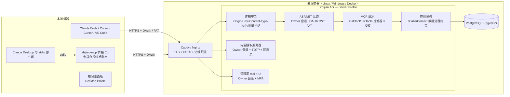

# 远程 MCP 与云端部署设计（Server Profile）

> 定位：本文是**方案设计 + 分阶段落地记录**。Phase 0（堵 P0/P1）已于 2026-10-28 实现，
> 具体落点见 §17；Phase 1 之后仍是设计。
> 当前线上行为（`maf_` 密钥 + 内置 OAuth 2.1 + `AgentClientGate`）见
> `docs/MCP-ACCESS.md`、`docs/MCP-OAUTH.md`；部署现状见 `docs/CLOUD-DEPLOYMENT.md`。
>
> 代码事实以 2026-10-28 的 `master` 为准；文中所有"现状"结论都附了文件与行号，便于复核。

---

## 0. 一句话结论

**不拆新项目、不做插件。** 同一份代码库产出两种宿主形态：

- **Desktop Profile**：Electron 打包，本机随机端口 + 一次性令牌，行为与今天一致。
- **Server Profile**：Linux / Windows 服务 / Docker，公网反代后暴露 `/mcp`，Owner 账号 + OAuth 2.1 / PAT。

再补一个第一方的本地桥接 CLI `zhijian-mcp`（stdio ↔ HTTPS），覆盖只支持 stdio 的客户端。

理由：

| 备选 | 为什么不行 |
| --- | --- |
| 拆出独立云端项目 | 知识库、检索、分身、聊天历史会出现两份实现，几周内必然不同步；而且安全修复要改两遍 |
| 做成插件 | 插件是"给核心加能力"的扩展点。宿主、身份、传输、审计属于核心，插件层管不到 |
| 只做 stdio 桥接 | 无法支持多用户/多客户端，也拿不到 OAuth 的受众绑定与撤销能力 |

主流厂商同样是"远程 Streamable HTTP + OAuth 2.1"：GitHub、Sentry、Linear、Cloudflare 的远程 MCP 都是这个形态；
Cloudflare 的 `mcp-remote` 负责给 stdio 客户端做桥接。本方案与之一致，只是桥接程序由我们自己出。

---

## 1. 现状审计

### 1.1 已有的正确决策（继续保留，别改）

| 项 | 位置 |
| --- | --- |
| OAuth 受众绑定（RFC 8707 `aud`），令牌不能跨资源重放 | `OAuth/OAuthTokenService.cs` |
| CIMD 的 SSRF 防线（拒绝重定向 / 私有地址 / 连接已校验 IP） | `OAuth/CimdClientMetadataResolver.cs` |
| 未登记工具默认拒绝（工具清单外不可调用） | `Domain/Agents/McpToolCatalog.cs` |
| 索引级鉴权失败封禁（`AgentAuthThrottle`，按 IP） | `Application/Agents/AgentAuthThrottle.cs` |
| 审计表不含请求正文 | `Persistence/AgentClientSchemaEntities.cs`、`ARCHITECTURE.md` §9 |
| 任务队列乐观 CAS 领取（多执行者安全） | `Infrastructure/Persistence/SqlSugarJobQueue.cs` |

### 1.2 必须修的问题

> 「状态」列对应本文 §13 的实施阶段：✅ = 已落地（Phase 0），⏳ = 未做。

| 级别 | 问题 | 位置 | 状态 |
| --- | --- | --- | --- |
| **P0** | **同意页不验证资源所有者**。公网任何人都能 `POST /oauth/register` → 打开同意页 → 勾全部 scope（含 `files:write`、`chat:read`）→ 拿令牌。而且匿名打开同意页就能看到全部知识库名称（信息泄露） | `Hosting/OAuthEndpoints.cs:66-156`、`OAuth/OAuthService.cs:276-370` | ✅ 临时闸门（回环或管理令牌）；账号登录 ⏳ |
| **P0** | **没配 `MAF_SERVER_TOKEN` 时 `/api` 完全不鉴权**，包括创建 MCP 客户端、签发/轮换密钥；漏配一个环境变量 = 管理面公开 | `Hosting/DesktopSecurity.cs:57-79`、`:104-121` | ✅ 服务端形态拒绝启动 |
| **P0** | **`server/discover` 免认证只看批量请求的第一条**。`[discover, tools/call]` 会让认证与工具准入整体被跳过 | `Hosting/AgentClientGate.cs:143-152`、`Hosting/McpProtocolDiagnostics.cs:139-141` | ✅ 批量一律 400，discover 仅单条 |
| **P0** | **工具授权 fail-open**：Content-Type 不含 `json`、JSON 解析失败都直接放行。且中间件用 `JsonNode` 解析，SDK 用自己的反序列化器绑定参数，重复键/大小写不同的键可能解析出不同结果 | `Hosting/AgentClientGate.cs:431`、`:462` | ✅ fail-closed + 单一解析结果 + 重复键拒绝 |
| **P1** | **`chat:read` 不受知识库范围约束**：受限客户端不传 `knowledgeBaseId` 就能读到所有库的历史 | `Mcp/ChatHistoryMcpTools.cs:28-40` | ✅ 应用层 + SQL 双层收窄 |
| **P1** | Server 模式仍注册 `local_*` 文件工具 → 在云上就是读写服务器文件系统 | `Hosting/McpModule.cs:50-54` | ✅ 按 Profile 不注册 |
| **P1** | `/mcp` 不校验 `Origin` / `Host`（MCP 规范要求 MUST），存在 DNS rebinding 面 | 无 | ✅ `McpTransportGuard` |
| **P1** | 管理面只有一条共享静态令牌：无账号、无 MFA、会话不过期；管理面与 MCP 同端口同域名 | `Hosting/DesktopSecurity.cs` | ⏳ Phase 1 |
| **P1** | `maf_` 密钥永不过期、不能限制来源 IP | `Domain/Agents/AgentClient.cs:66-75` | ⏳ Phase 1（PAT v2） |
| **P2** | `RequireClientKey=false`、CIMD 的 `AllowInsecureHttp` / `AllowPrivateAddresses` 只打警告，不拒绝启动 | `Hosting/AgentClientGate.cs:59-64` | ✅ 服务端形态拒绝启动 |
| **P2** | 签名私钥明文落盘；写类工具没有 `destructiveHint`，客户端不会弹确认 | `OAuth/OAuthTokenService.cs`、`Mcp/*McpTools.cs` | ⏳ Phase 2 / 4 |

### 1.3 两个根因

1. **授权在 HTTP 中间件里"偷看"请求体**，与真正执行工具的那份参数不是同一份数据 → 靠加固中间件永远补不完。
2. **"本机即可信"的桌面假设被原样带到服务端模式** → 缺配置就全放行、注册本机文件工具、管理面无身份。

---

## 2. 目标架构



---

## 3. 核心设计

### 3.1 宿主形态 + 启动守卫

新增 `Hosting:Profile = Desktop | Server`。Electron 启动时显式传 `Desktop`；Docker / systemd / Windows 服务默认 `Server`。
**两种形态的差异在启动期一次性决定**，不做运行时开关切换。

| 项 | Desktop | Server |
| --- | --- | --- |
| `/api` 鉴权 | Electron 注入的一次性令牌（现状） | Owner 会话 + TOTP；无 Owner 时只开放 `/setup` |
| `local_*` 文件工具 | 按 `Agent:FileRoots` 注册 | **不注册** |
| `Mcp:Servers` 进程内 stdio 客户端 | 允许 | 禁用 |
| `/api/desktop/*` | 映射 | 不映射 |
| OAuth DCR | 可开 | 默认关闭（优先 CIMD + 预注册） |
| 监听地址 | 127.0.0.1 随机端口 | 127.0.0.1:5056，对外由反代暴露 |
| `IncludeErrorDetail` | 现状 | **强制 false**（见 §9） |
| 单副本约束 | 不适用 | **默认单副本**，多副本见 §10 |

**Server Profile 下拒绝启动**（非 0 退出码 + 明确中文原因）：

- `Mcp:RequireClientKey=false`
- `Mcp:OAuth:Cimd:AllowInsecureHttp=true` 或 `AllowPrivateAddresses=true`
- `Mcp:OAuth:Enabled=true` 但 `Issuer` 不是 `https` 绝对地址
- 监听非回环 HTTP 且 `Server:TrustForwardedHeaders=false`
- `Hosting:ReplicaCount > 1` 且限流未切到共享实现（见 §10）

只警告不拒绝：`AllowDynamicRegistration=true`、`Agent:FileRoots` 非空、`Server:EnableMdns=true`。

新增 `Zhijian.Api doctor` 子命令输出同一份清单（CI 与排障共用一套判定）。

### 3.2 身份：管理与同意页必须由 Owner 登录

- **首次初始化**：生成一次性 setup code（30 分钟有效），打到日志并写 `<数据根>/setup-code`（0600）。访问 `/setup` 兑换。也可 `Zhijian.Api admin create-owner`。参考 Jenkins 的 `initialAdminPassword`。
- **口令**：`PasswordHasher`（PBKDF2）。**TOTP（RFC 6238）默认强制**；Passkey 留到 Phase 4。
- **会话**：`__Host-zj_session`（HttpOnly / Secure / SameSite=Strict），空闲 30 分钟、绝对 12 小时；配 Antiforgery；Data Protection 密钥持久化到数据卷。
- **`/oauth/authorize`**：GET 与 POST 都要求 Owner 会话，否则 302 到 `/login?return=`。同意页必须显示：客户端名称、`redirect_uri` 的**主机**、注册来源（CIMD / DCR / 预注册）；首次出现的客户端标红。
- `MAF_SERVER_TOKEN` 降级为机器对机器管理令牌：默认关闭，开启时必须同时配置 IP 白名单。

### 3.3 MCP 认证：三条通道

| 通道 | 适用 | 规格 |
| --- | --- | --- |
| **OAuth 2.1**（主路径） | Claude Code、Codex、Cursor、VS Code、Claude Desktop 自定义连接器 | PKCE S256 + RFC 8707 `aud`（沿用现有实现）；**访问令牌 10 分钟**；刷新令牌轮换，**检测到重复使用即吊销整组** |
| **PAT v2**（`zjp_`，替换 `maf_`） | 脚本、CI、不支持 OAuth 的客户端 | 必须有过期时间（默认 90 天，最长 1 年）；可选 CIDR 白名单；HMAC-SHA256(pepper) 存储；只认 `Authorization` 头 |
| **桥接 CLI** | 只支持 stdio 的客户端 | 本地完成 OAuth（loopback 回调；无浏览器时设备码 RFC 8628）；刷新令牌入系统钥匙串，访问令牌只留内存 |

实现方式改为标准 ASP.NET Core `AuthenticationHandler`（scheme `ZhijianMcp`），两种令牌都翻译成 `ClaimsPrincipal`，
`MapMcp(...)` 上挂 `.RequireAuthorization("mcp")`。**认证不再由自定义中间件"先读体再判定"**。

`server/discover` 免认证的判定收紧为：**单条消息、`method` 完全等于 `server/discover`**，且 SDK 过滤器内再确认一次
"未认证请求只能执行 discover"。

PAT 存储用 HMAC-SHA256(pepper) 而不是裸 SHA-256 的理由要写清楚：对 256 位随机密钥而言 SHA-256 本身已不可爆破，
HMAC 的收益是**同一密钥在测试库与生产库的哈希不同**，避免测试库的哈希被直接搬到生产伪造记录。

### 3.4 授权下沉到 SDK 过滤器

`AgentClientGate` 只保留传输职责（请求体上限、速率、并发）。工具授权移到 MCP SDK 的 `CallTool` / `ListTools` 请求过滤器
（`AddCallToolFilter` / `AddListToolsFilter`，签名以 `ModelContextProtocol.AspNetCore` 2.2.0 为准）。
这样判定所用的参数，就是工具实际绑定的那份 `Arguments`，两套解析器不一致的问题从根上消失。

用声明式属性替代手工维护的 `McpToolCatalog`：

```csharp
[McpServerTool(Name = "get_document_content", ReadOnly = true)]
[RequiresCapability(AgentClientCapabilities.KnowledgeRead)]
public Task<string> GetDocumentContentAsync(
    [DocumentRef] string documentId, CancellationToken cancellationToken = default) => ...
```

- 启动期反射校验：注册了但没有 `[RequiresCapability]` 的工具 → **拒绝启动**。把"默认拒绝"从运行时提前到启动期。
- `[KnowledgeBaseRef]` / `[DocumentRef]` 标注的参数由过滤器统一做范围校验（含 `documentId → 所属知识库` 回查）。
- `ListTools` 只返回调用方有权限的工具。
- **纵深防御**：应用服务注入 `ICallerContext`，查询强制带允许的知识库范围。`ChatHistoryService` 在受限主体下
  按允许的知识库过滤，且不返回 companion / avatar 来源。即使某个工具漏标属性，数据层也不会越权。

### 3.5 传输层加固

- TLS 1.2+、HSTS、`AllowedHosts` 白名单。
- **`Origin` 出现就必须在白名单内**，否则 403；`/mcp` 不开 CORS。`Host` 必须在白名单内。
- POST 必须 `application/json`，否则 415；**拒绝 JSON-RPC 批量请求**；体 ≤ 1 MB；每客户端并发上限；请求超时。
- 不接受 query 里的令牌；日志不记录 `Authorization`（细则见 §9）。

### 3.6 MCP 特有威胁

| 威胁 | 对策 |
| --- | --- |
| 资料内 prompt 注入诱导调用写工具 | 写工具默认不授予；声明 `destructiveHint` / `readOnlyHint`；写操作单独限流；`upload_document` 类型与大小白名单 |
| 批量导出 | 每客户端每日读取字符配额；单次工具输出上限 |
| 工具描述被替换（rug-pull） | 工具描述静态；Server Card 带工具 schema 哈希；审计记录 schema 哈希变化 |
| 令牌泄露 | 短访问令牌 + 刷新令牌重放检测 + 新 IP / 新客户端告警 |

### 3.7 机密

- Server Profile 下签名私钥、令牌 pepper、DB 口令、LLM 密钥统一从 `/run/secrets`（Docker）/
  `LoadCredential=`（systemd）/ `C:\ProgramData\Zhijian\secrets`（ACL 仅服务账号）读取；首次启动自动生成。
- 签名密钥轮换：新旧 `kid` 在 JWKS 并存至旧令牌全部过期，`admin rotate-signing-key` 触发。

---

## 4. 本地 Agent 怎么连云端

设置页新增"远程连接"，按客户端一键生成：

```bash
# Claude Code（OAuth：进入 claude 后 /mcp → Authenticate）
claude mcp add --transport http zhijian https://kb.example.com/mcp
# Claude Code（PAT）
claude mcp add --transport http zhijian https://kb.example.com/mcp --header "Authorization: Bearer $ZHIJIAN_TOKEN"
```

```toml
# Codex ~/.codex/config.toml；OAuth 用 `codex mcp login zhijian`
[mcp_servers.zhijian]
url = "https://kb.example.com/mcp"
bearer_token_env_var = "ZHIJIAN_TOKEN"
```

```jsonc
// Cursor ~/.cursor/mcp.json（不填 headers 走 OAuth）
{ "mcpServers": { "zhijian": { "url": "https://kb.example.com/mcp",
  "headers": { "Authorization": "Bearer ${env:ZHIJIAN_TOKEN}" } } } }

// VS Code .vscode/mcp.json
{ "servers": { "zhijian": { "type": "http", "url": "https://kb.example.com/mcp",
  "headers": { "Authorization": "Bearer ${input:zj}" } } },
  "inputs": [{ "id": "zj", "type": "promptString", "password": true }] }

// Claude Desktop：自定义连接器（OAuth，需公网可达），或用桥接
{ "mcpServers": { "zhijian": { "command": "zhijian-mcp", "args": ["connect", "https://kb.example.com"] } } }
```

**桥接 CLI** `tools/Zhijian.McpBridge`（单文件发布，随桌面安装包分发）：

- 命令：`login`（PKCE loopback / `--device` 设备码）、`connect`、`status`、`logout`。
- 令牌：Windows Credential Manager / DPAPI，macOS Keychain，Linux libsecret。
- 可选 SPKI 证书锁定（自签名场景）。
- stdio 侧只做 `Content-Length` 帧转 HTTP 流式响应，不缓存响应体。

---

## 5. 部署便捷性

| 目标 | 方式 |
| --- | --- |
| **Docker** | compose 默认 `app` + `caddy`（自动 ACME）。`.env` 只需 `ZJ_PUBLIC_URL` + ACME 邮箱；app 端口不对外；机密首启自动生成到数据卷 |
| **Linux** | 沿用 `deploy/linux/install.sh`，补 systemd 加固（`ProtectSystem=strict`、`NoNewPrivileges`、`PrivateTmp`、`ReadWritePaths`、`LoadCredential`）+ Caddy/Nginx 示例 |
| **Windows Server** | 新增 `deploy/windows/install.ps1`：程序进 `Program Files`、数据进 `ProgramData` 并收紧 ACL、`New-Service` + 虚拟账号 `NT SERVICE\Zhijian` + `UseWindowsService()`、防火墙仅开 443 |
| **无公网 IP** | compose `tunnel` profile（cloudflared / Tailscale Funnel）。Claude Desktop 自定义连接器要求公网可达，这类场景必需 |
| **首次上线** | `docker compose up` → 打开 `https://域名/setup` → 输入日志里的 setup code → 建 Owner + 绑定 TOTP |

---

## 6. 迁移路径：`maf_` → `zjp_`（PAT v2）

> 目标：**任何时刻都不会有客户端"突然失联"**；同时不给旧密钥留永久后门。

### 6.1 关键决策

| 问题 | 决策 | 理由 |
| --- | --- | --- |
| 双写还是双读 | **双读，不双写** | 新建/轮换只发 `zjp_`；认证侧按前缀路由到两套校验器。DB 里两张表并存到清理日 |
| 迁移期多长 | **180 天**（`Mcp:LegacyKeyGraceDays`，允许 30–365） | 覆盖一个季度末 + 一个长假周期；短于 30 天会撞上客户端的发布冻结 |
| 到期后拒绝还是降级 | **先降级只读（30 天缓冲），再拒绝** | 只读期让客户端"能用但会报错提示"，用户有时间处理；直接 401 会让整条链路瞬间断开且无法自查 |
| 是否自动迁移 | **不自动** | 密钥明文只在生成时出现一次，静默轮换必然让正在使用旧密钥的客户端断线。必须用户点击并粘贴新配置 |
| 旧密钥哈希何时删 | 拒绝后**再保留 365 天**（`Mcp:LegacyKeyPurgeAfterDays`） | 允许紧急回滚（`LegacyKeyMode=allow` + 重启即可复活） |

### 6.2 四个阶段

| 阶段 | 时间 | `maf_` 行为 | 系统动作 |
| --- | --- | --- | --- |
| **A 影子期** | T+0 ~ T+30 | 正常可用 | 新签发的只有 `zjp_`；管理页给每个 legacy 客户端打"待迁移"标；启动日志输出待迁移数量（一行） |
| **B 催促期** | T+30 ~ T+150 | 正常可用 | 响应头 `Warning: 299 - "deprecated key format"` + `Deprecation`/`Sunset`；审计行记 `legacy_key=true`；**每周一次**汇总日志（不是每请求刷屏）；管理页红色横幅；`/api/mcp/diagnostics` 列入待办 |
| **C 只读期** | T+150 ~ T+180 | **降级只读**：仅允许 `ReadOnly=true` 工具；写工具返回 `-32003`，消息明确写"密钥格式已废弃，请轮换" | 同上 + 每日汇总 |
| **D 拒绝期** | T+180 之后 | **401**，不是 403、更不是匿名降级 | `WWW-Authenticate: ... error="invalid_token"`，`error_description` 指向轮换文档 URL |

阶段由时间自动推导，可用 `Mcp:LegacyKeyMode = allow | readonly | deny` 显式覆盖（运维回滚、事故处置）。

### 6.3 通知现有客户端（四层，前两层必须做）

1. **管理页"迁移助手"**：每个 legacy 客户端显示最后使用时间、最后来源 IP、"一键轮换"。轮换弹窗同时给出
   新密钥 + 该客户端类型的配置片段（Claude Code / Cursor / curl），复制即可。
2. **结构化信号**：
   - 响应头 `Warning` / `Deprecation`（RFC 9745）/ `Sunset`（RFC 8594）。
   - **注意**：MCP 客户端通常不读这些头，所以它们只是"给中间件和 curl 用"，不能当唯一通知手段。
3. **可抓取的迁移状态**：`GET /api/mcp/migration-status` 返回每个客户端的 `keyFormat`、`daysUntilReadOnly`、
   `lastUsedAt`。接入现有监控（Prometheus textfile 或 JSON 采集）后可做"到期前 14 天"告警。
4. **可选 Webhook**：`Server:Alerts:WebhookUrl`，阶段切换时推一次，内容只有客户端数量与阶段，不含密钥。

### 6.4 客户端配置更新流程（用户视角）

```
管理页「迁移助手」→ 点「轮换」→ 复制新密钥 + 配置片段
  → 粘贴到 Claude Code / Cursor / 客户端配置
  → 在该客户端里重新连接，调用一次 tools/list 确认
  → 迁移助手显示「已迁移（zjp_）」→ 旧密钥行变为「待清理」
```

阶段 C 之前完成即可；阶段 C 期间旧的 `.env` / CI Secret 仍能读、不能写，是最后的安全缓冲。

### 6.5 回滚

| 场景 | 动作 |
| --- | --- |
| 大面积客户端断线 | `Mcp:LegacyKeyMode=allow` + 重启；旧哈希还在库里，立即恢复 |
| 某客户端密钥泄露 | 删除该客户端（`agent_client_calls` 历史保留）；无需等阶段 |
| 清理后发现漏网客户端 | 只能重新签发新密钥；因此 §6.2 的 D 阶段留 90 天观察期再物理清理 |

### 6.6 不做的事

- 不做"旧密钥自动换成新密钥并回填客户端配置"——配置文件在用户机器上，服务端改不到。
- 不做"同一客户端同时有两个有效密钥"的通用能力。轮换即失效，语义简单；
  需要双活窗口时用**新建客户端 + 旧客户端保留 7 天**来模拟（管理页提供"克隆配置"按钮）。

---

## 7. 审计保留期与分区

### 7.1 现状事实

- `docs/ROADMAP.md` §4「审计/行为表没有保留期」已记录：`agent_client_calls`、`oauth_auth_events`、`avatar_feed_entries` 三张表**只进不出**。
- 实际上同类表是四张（`plugin_audit_events` 同样只写不删，只是量级小）。
- `jobs` 与 `index_outbox` **已有**保留期实现，可照抄：`Jobs:RetentionHours=168` 由 `JobScheduler.PurgeAsync`
  （`Application/Jobs/JobScheduler.cs:134`）驱动；`Indexing:OutboxRetentionHours=168` 由 `IndexLifecycleManager` 驱动。
- 已有 `schema` 里的时间列统一是 `occurred_at timestamptz`。

### 7.2 云部署必做项

**A. 保留期配置**（默认值按 profile 区分）

```jsonc
"Server": {
  "Audit": {
    "RetentionDays": 90,          // Desktop 默认 0 = 永不清理（保持现状）
    "MinRetentionDays": 30,       // 低于此值拒绝启动（合规下限）
    "PurgeBatchSize": 5000,
    "PurgeIntervalMinutes": 60,
    "Partitioning": "auto"        // auto | on | off
  }
}
```

**B. 清理实现**（照 `jobs` 的套路）

- 日级后台任务（`WorkerModule` 里注册，不进 JobScheduler，避免和业务任务抢配额）。
- **分批删除**，每批 `LIMIT PurgeBatchSize` + 200 ms 间隔，避免长事务与锁等待。
- 优先显式 SQL（`SqlSugarStudyRepository` 已有先例）：`DELETE FROM agent_client_calls WHERE ctid IN (SELECT ctid FROM agent_client_calls WHERE occurred_at < $1 LIMIT $2)`。
  用 `ctid` 而不是 `id IN (...)`：省一次索引回查，且分区表同样适用。
- 清理本身要留痕：写 `ops_events`（新表，保留 365 天）一行"purged N rows from T"。
  **不能写回被清理的表**（自删自记会形成循环）。

**C. 分区（真正的分水岭）**

| 项 | 内容 |
| --- | --- |
| 触发 | 单表 > 500 万行 或 `pg_relation_size` > 5 GB。**比 `ROADMAP.md` 记的 1000 万行 / 10 GB 提前一半**：那是本地单机口径，公网暴露后行数增长至少快一个量级，等到千万行再动手，迁移窗口和死元组都会明显变大 |
| 方式 | PostgreSQL 声明式 `RANGE` 分区，按 `occurred_at` 月分区 |
| 收益 | 过期清理从 `DELETE`（上亿死元组压垮 autovacuum）变成 `DROP PARTITION`（瞬时、零膨胀） |
| **硬约束** | 分区表的主键**必须包含分区键**。现有 `PRIMARY KEY (id)` 不满足 → 必须改为 `PRIMARY KEY (id, occurred_at)` 或 `(occurred_at, id)`。这是**破坏性 schema 变更** |

分区迁移步骤（单次维护窗口，10 分钟量级）：

1. 停写（进入只读维护模式，或 `LOCK TABLE ... IN ACCESS EXCLUSIVE MODE`）。
2. `ALTER TABLE agent_client_calls RENAME TO agent_client_calls_legacy;`
3. 建父表（`PARTITION BY RANGE (occurred_at)`）+ 历史分区 + 当月分区 + 下月分区（预建 2 个）。
4. `INSERT INTO agent_client_calls SELECT * FROM agent_client_calls_legacy ORDER BY occurred_at;`
5. 校验行数一致 → `DROP TABLE agent_client_calls_legacy;`
6. DDL 放进 `DatabaseInitializer`，并让 `SchemaStamp` 指纹覆盖分区结构（否则新库不会建分区）。

**D. 分区后的保留策略**

- 过期分区用 `DETACH PARTITION` + `DROP TABLE`，不再是 `DELETE`。
- 保留"最近 N 个月 + 当前月"分区，预建下月；缺分区写入会直接失败（PostgreSQL 默认无 default 分区），
  所以**必须有"预建下月分区"的日级任务**，否则跨月 00:00 全部写入报错。这是最容易漏的一条。

**E. 监控**

| 指标 | 告警线 |
| --- | --- |
| 单表行数 / 体积 | > 500 万行 或 > 5 GB（未分区时） |
| 最早分区 age | > RetentionDays + 7 |
| 下月分区是否存在 | 缺 → 立即告警（否则跨月写入全挂） |
| purge 最后成功时间 | > 48h → 告警 |
| 死元组比例 | > 20% 持续 1h |

**F. 隐私边界**

- 审计只记 `clientId / tool / knowledgeBaseId / outcome / status / durationMs`，**不含搜索词与正文**（与 `MCP-ACCESS.md` 一致）。
- 保留期不是"越短越安全"：太短无法溯源，"谁在什么时候导出了哪个库"查不到。90 天是折中，且 `RetentionDays < 30` 直接拒绝启动。

---

## 8. 备份与恢复

> 公网部署后，数据丢失的后果从"重装一次"变成"用户资料永久消失"。备份不属于可选运维项。

### 8.1 目标

| 指标 | 目标 |
| --- | --- |
| RPO（可接受丢失窗口） | ≤ 24 小时（日备）；开启 WAL 归档后 ≤ 15 分钟 |
| RTO（恢复耗时） | ≤ 2 小时（含验证） |
| 演练频率 | 每季度一次，且**每次升级 PG 大版本前必做** |

### 8.2 必须一起备份的四类东西

| 类别 | 内容 | 单独备份的后果 |
| --- | --- | --- |
| 数据库 | `pg_dump -Fc`（逻辑一致） | — |
| 原始文件 | `App_Data/uploads/`（restic/borg 增量） | 知识库有记录但原文打不开 |
| **机密** | `App_Data/oauth/signing-key.pem`、Data Protection 密钥、`.env`/secrets | OAuth 令牌全失效（可接受）；但 cookie 也会失效，管理员被登出 |
| **元数据清单** | 版本号、`Embedding:Model` 标识、`SchemaStamp`、分区状态、各表行数 | **最容易漏**：换模型后重建索引会混入不同维度/语义的向量，检索质量隐性劣化且无法察觉 |

### 8.3 方案分层

| 层 | 手段 | 频率 | 用途 |
| --- | --- | --- | --- |
| L1 | `pg_dump -Fc` → 加密 → 对象存储 | 每日 03:00 | 主力恢复手段，可跨版本迁移 |
| L2 | 卷快照（LVM/ZFS/EBS） | 每日 | 整机回滚；**不能替代 L1**（运行中 PG 的文件级快照可能不一致） |
| L3 | WAL 归档（`archive_mode=on`） | 连续 | 只对"误删一个知识库"这类场景有价值 |
| L4 | 异地副本 + 对象锁（WORM） | 随 L1 | 勒索软件防护 |

### 8.4 脚本与接口

- `scripts/backup-zhijian.sh`（Linux）/ `scripts/Backup-Zhijian.ps1`（Windows）：
  `pg_dump -Fc` + `tar uploads` + `copy secrets` + 生成 `manifest.json` → 加密（restic 原生或 `age`）→ 上传。
- `scripts/restore-zhijian.sh <backup>`：`pg_restore --clean --if-exists -j 4` → 覆盖 uploads →
  恢复 secrets 并 `chmod 0600` → 校验 `manifest.json` 与库内 `SchemaStamp` 一致。
- **备份新鲜度进健康检查**：脚本成功后 `POST /api/ops/backup-report`（需管理令牌）；
  `/api/health` 返回 `lastBackupAt`，超过 36 小时未备份 → `degraded`。没有这一步，备份会静默失效几个月。

### 8.5 恢复演练清单（每季度）

1. 在**独立目录 + 独立端口**起一个恢复实例，绝不碰生产。
2. 恢复 → 启动 → `doctor` 通过。
3. 逐项验证：登录可用（说明 Data Protection 密钥对）、知识库数量一致、随机抽 3 个文档检索命中、
   `tools/list` 可用、`agent_client_calls` 抽样可查、分区存在且下月分区已预建。
4. 记录到 `docs/BACKUP-DRILL.md`：日期、备份来源、耗时、失败项、修复项。
5. **没做过演练的备份 = 没有备份。** 第一次演练建议在 Phase 2 上线前完成。

### 8.6 常见坑

- 只备份 DB 不备份 `uploads`：文档记录在，原文 404，用户会认为"数据丢了"。
- 恢复后没恢复 `signing-key.pem`：所有 OAuth 客户端需重新授权（可接受但要写进恢复手册，否则会被当成故障）。
- 恢复后忘了 `chmod 0600`：私钥变成全员可读。
- 备份文件未加密：备份里是知识库全文，等同于把整个知识库带走。

---

## 9. 日志脱敏

### 9.1 现状与真实泄漏点

| 位置 | 现状 | 风险 |
| --- | --- | --- |
| `Hosting/HostBootstrap.cs:39` | `AddJsonConsole` + `FileLoggerProvider`，按天一个 `api-yyyyMMdd.log` | **文件没有清理逻辑**，只有 append → 磁盘单调增长；日志内含审计级信息 |
| `Infrastructure/PortablePostgres/PortablePostgresHost.cs:946` | `IncludeErrorDetail = true` | Npgsql 异常消息可能带参数值与行数据，直接进日志 |
| `Plugins/PluginProcessHost.cs:902` | `[_logger.LogInformation("Plugin {PluginId} [{Level}] {Message}")]` | **插件 stdout/stderr 原样入日志** → 插件打印用户资料即泄漏。这是最实在的一条 |
| `PluginPaths.cs:98`、`PluginProcessHost.cs:157/977/1014` | `{Message}` 传异常消息 | 低风险（系统异常），但同样不该无条件打 |
| `Hosting/HostPipeline.cs:38-60` | 请求日志只记 method/path/status/duration | 安全；但要防止未来把 query string 写进去 |
| `Hosting/McpProtocolDiagnostics.cs` | 记录 method / era / status / UA / IP | 可接受；UA 与 IP 属个人信息，保留期与审计表一致 |
| 审计表 | 不含正文（已确认） | 安全 |

`docs/MCP-ACCESS.md` 说的"审计不含请求正文"是对的，但**应用日志是另一条管道**，此前没有被约束。

### 9.2 三条铁律

1. **默认不打请求体。** 任何 `ILogger` 调用不得传入工具参数、搜索词、文档内容、Prompt。
   调试需要时用 `Mcp:Diagnostics:LogToolArguments=true`（默认 false，**且只在 Desktop Profile 允许**，Server 下置 true 直接拒绝启动）。
2. **结构化字段白名单。** 可进日志：`clientId`、`tool`、`outcome`、`status`、`durationMs`、`knowledgeBaseId`、`documentId`、
   `protocolVersion`、`era`。永不进日志：`authorization`、`X-Api-Key`、`token`、`secret`、`password`、`query`、`content`、`arguments`、`prompt`。
3. **兜底脱敏不能是唯一防线。** 它只用于第三方库与异常消息；自有代码必须靠"不传"来保证。

### 9.3 实现

| 改动 | 说明 |
| --- | --- |
| `Infrastructure/Logging/RedactingLoggerProvider.cs`（新） | 包装现有 provider，对渲染后的消息做正则替换（`[GeneratedRegex]` 预编译），命中敏感键的值替换为 `***`。启动时打一行"redactor: N patterns" |
| `FileLoggerProvider` 加配额 | `Logging:File:RetainDays=14`、`MaxTotalMB=512`；启动与每日各清理一次；同一天超过大小上限滚动为 `api-20261028.1.log` |
| `IncludeErrorDetail` | Server Profile 强制 `false`；Desktop 保持 `true`（本机调试价值高于风险） |
| 插件输出 | 改为 `LogDebug` + 截断 4 KiB；新增 `Plugin:CaptureStdout = errors-only`（默认）。**这是行为变更**，需写进发布说明 |
| 异常处理器 | `UseExceptionHandler` 改成只记 `exception.GetType()` + 消息，栈只进 Debug 级；ProblemDetails 不回传消息（现状已只回 traceId，保持） |
| 审计表断言 | 单元测试用反射断言 `AgentCallRecord` 的属性集合等于白名单（新增字段必须显式加入测试），防止未来有人加 `Request` 字段 |
| 自动化门禁 | `scripts/Check-LogHygiene.ps1`：正则扫描所有 `.cs` 的日志模板占位符，命中黑名单（`Query|Content|Prompt|Arguments|Body|Token|Key|Secret|Password`）即返回非 0。挂到发布脚本里 |

### 9.4 验收

```powershell
# 1. 结构扫描：模板占位符不得出现敏感名
powershell -NoProfile -File scripts\Check-LogHygiene.ps1

# 2. 运行时验证：用带敏感参数的真实调用跑一遍，然后搜日志
Select-String -Path publish\desktop\App_Data\logs\api-*.log `
  -Pattern 'Authorization|Bearer |zjp_|maf_|api_key|"query"' -CaseSensitive:$false
# 期望：0 条内容命中（"Rejected ... without a valid token" 这类拒绝日志允许存在，但不得带值）
```

日志文件本身也要在 `.gitignore`（已有 `App_Data` 规则覆盖）。

---

## 10. 限流与多副本

### 10.1 现状

| 组件 | 状态 | 位置 |
| --- | --- | --- |
| `AgentRateLimiter` | 进程内 `ConcurrentDictionary` 令牌桶，`PruneThreshold=512`，10 分钟未访问回收，重启清零 | `Application/Agents/AgentRateLimiter.cs` |
| `AgentAuthThrottle` | 进程内按 IP 的失败窗口 | `Application/Agents/AgentAuthThrottle.cs` |
| `McpProtocolDiagnostics` | 进程内环形缓冲 | `Hosting/McpProtocolDiagnostics.cs` |
| `McpClientRegistry` | 进程内 30 秒缓存 | `Mcp/McpClientRegistry.cs` |

### 10.2 多副本下的失效模式（必须先说清）

| 场景 | 后果 |
| --- | --- |
| N 副本 + 负载均衡 | 实际额度 = N × 配置值 |
| 轮询分配 | `Retry-After` 不准；客户端在两副本间来回命中 |
| 认证爆破 | 封禁阈值放大 N 倍，且被封 IP 换副本即可继续 |
| 滚动更新 / 崩溃 | 计数清零，爆破者可用部署窗口重置配额 |
| 诊断页 | 每个副本各说各话，排障时互相矛盾 |
| **启动期** | `DatabaseInitializer` / `SchemaStamp` 并发执行 → 多个副本同时 `CREATE TABLE` 互相冲突。**这是多副本的真正阻碍，比限流严重** |

### 10.3 结论：分三档，云端默认 T1 + T3

| 档 | 做法 | 适用 | 成本 |
| --- | --- | --- | --- |
| **T1 进程内**（默认） | 保持现状；`/api/mcp/diagnostics` 明确返回 `rateLimit: { mode: "in-process", multiReplicaSafe: false }`；启动日志打一行同样的提示 | 单副本，Phase 0–3 的支持形态 | 0 |
| **T2 Redis** | Lua 原子滑动窗口/令牌桶，key `mcp:rl:{clientId}`、`auth:throttle:{sha256(ip)}`；TTL 自动回收 | 自建小集群（Phase 4） | 中：新增依赖 + 降级策略 |
| **T3 边缘限流**（推荐与 T1 叠加） | Caddy `rate_limit` / Nginx `limit_req` + `limit_conn`，按 IP 与 `Authorization` 前缀粗过滤 | 公网部署**默认启用** | 低，代码零改动 |

T3 的价值：即使多副本让应用层额度放大 N 倍，最外层的爆破面已经被挡住，剩下只是"N 倍配额"这种可接受偏差。
对绝大多数实例来说，**T1 + T3 就够了，不必引入 Redis**。

### 10.4 T2 的设计细节（真要做时）

- **原子性**：必须用 Lua（`StackExchange.Redis` 的 `ScriptEvaluate`），不能用 GET→判断→SET。
- **IP 哈希**：`sha256(ip + salt)` 作 key，避免 Redis 里出现明文 IP（隐私 + key 泄露）。
- **降级**：Redis 连不上时回退到本地桶并打 `Warning` + 计数指标；**不要 fail-open 到无限**，
  也不要 fail-closed 到全拒（限流是保护手段，不是业务约束——与现有代码注释一致）。
- **启动检查**：`doctor` 里 ping Redis；Server Profile + `ReplicaCount>1` + Redis 不可达 → 拒绝启动。
- **会话也要共享**：多副本必须共享 Data Protection 密钥环（同一个数据卷或 DB 存储），否则登录态在副本间失效。

### 10.5 多副本的前置条件清单（缺一不可）

1. `pg_advisory_lock` 保护的 schema 初始化。
2. 共享限流（T2 或 T3 兜底）。
3. 共享 Data Protection 密钥环。
4. `WorkerModule` 的周期任务确认幂等，或加分布式选主（`pg_advisory_lock` 或 leader 表）。
5. `McpProtocolDiagnostics` 接受"每副本各自采样"，或改为写表。

因此本文明确：**Phase 0–3 只支持单副本**，并在启动日志与文档中写死。水平扩展是 Phase 4 的独立议题，
不要用"多开几个容器"来临时扩容。

---

## 11. 依赖与供应链安全

### 11.1 现状

- **无 CI 配置**（仓库里没有 `.github/`、`.gitlab-ci.yml`）。
- 直接依赖 15 个，关键：`ModelContextProtocol.AspNetCore 2.2.0`、`Npgsql 9.0.4`、`SqlSugarCore 5.1.4.221`、
  `Microsoft.ML.OnnxRuntime 1.30.0`、`PdfPig 0.1.9`、`DocumentFormat.OpenXml 3.3.0`、`Whisper.net 1.9.1`。
- 基础镜像：`mcr.microsoft.com/dotnet/{sdk,aspnet}:10.0`、`node:22-alpine`、`pgvector/pgvector:pg17`（**tag 未固定 digest**）。
- `scripts/Download-ExternalTools.ps1` 从 `johnvansickle.com`、`evermeet.cx` 下载 ffmpeg，
  **没有哈希校验**；`model.onnx` 走 git 对象但同样没有内容校验。

### 11.2 三道门禁

| 门禁 | 命令 | 失败标准 |
| --- | --- | --- |
| NuGet 漏洞 | `dotnet list package --vulnerable --include-transitive` | 出现 `Critical` / `High` → 阻断 |
| NuGet 审计（构建期） | `Directory.Build.props`：`<NuGetAudit>all</NuGetAudit>`、`<NuGetAuditMode>all</NuGetAuditMode>`、`<NuGetAuditLevel>moderate</NuGetAuditLevel>` | 构建 warning 视为失败 |
| 依赖锁定 | `<RestorePackagesWithLockFile>true</RestorePackagesWithLockFile>`，提交 `packages.lock.json`；CI 用 `--locked-mode` | 锁文件不匹配 → 阻断 |
| 镜像 CVE | `trivy image --severity HIGH,CRITICAL --exit-code 1 zhijian-api:integrated` | 命中 → 阻断 |
| 镜像固定 | `FROM mcr.microsoft.com/dotnet/aspnet:10.0@sha256:...` | 用浮动 tag → 阻断（tag 漂移是供应链攻击的常见入口） |

> `dotnet list package --vulnerable` 即使发现问题**退出码仍为 0**，所以必须解析输出或用 `--format json` 判空。
> 这是最容易写成"永远绿灯"的一步。

### 11.3 无 CI 时的落地方式（本仓库的现实约束）

在 `scripts/` 下补齐并在**唯一出口** `Publish-Release.ps1` 里调用：

- `scripts/Check-Dependencies.ps1`：NuGet 漏洞 + 锁文件一致性。
- `scripts/Check-Image.ps1`：`docker scout cves` 或 `trivy`（本机无 Docker 时跳过并打 `Warning`，不静默通过）。
- `scripts/Check-LogHygiene.ps1`（见 §9）。
- `scripts/Check-Architecture.ps1`、`Check-DocLinks.ps1`（已有）。

同时给出可选的 GitHub Actions 工作流片段（`.github/workflows/security.yml`）供后续启用，但**不假设它一定存在**。

### 11.4 供应链其它项

| 项 | 做法 |
| --- | --- |
| 外部二进制校验 | `Download-ExternalTools.ps1` 增加 `ExpectedSha256` 表；下载后 `Get-FileHash` 比对，不匹配即失败。首次获取时人工核对并落表 |
| SBOM | 发布时生成 CycloneDX（`dotnet CycloneDX` 或 `syft`），随 Release 附件发布 |
| 产物签名 | Windows 用 Authenticode；Linux 用 minisign，公钥写进文档 |
| .NET / Node 生命周期 | 跟踪支持策略（LTS 到期前 6 个月排升级），`doctor` 输出版本与支持状态 |
| 依漏洞处置 SLA | Critical 24h、High 7d、Medium 下一发布周期。**写下来，否则永远不会修** |

---

## 12. 改动清单

**新增**

- `Hosting/HostProfile.cs`、`Hosting/SecurityPostureGuard.cs`（启动守卫 + `doctor`）
- `Identity/`：Owner 账号、TOTP、会话、`/login`、`/setup`
- `Mcp/Security/`：`McpAuthenticationHandler`、`McpToolAuthorizationFilter`、`RequiresCapabilityAttribute` /
  `KnowledgeBaseRefAttribute` / `DocumentRefAttribute`、`McpTransportGuard`
- `Application/Security/ICallerContext.cs`
- PAT v2 领域模型 + 迁移状态机（`LegacyKeyMode`、`migration-status` 端点）
- `Application/Ops/AuditRetentionService.cs` + `ops_events` 表 + 分区预建任务
- `Infrastructure/Logging/RedactingLoggerProvider.cs`
- `tools/Zhijian.McpBridge/`
- `deploy/windows/`、`deploy/caddy/`、compose 的 `tls` / `tunnel` profile
- `scripts/{Check-Dependencies,Check-Image,Check-LogHygiene}.ps1`、`{backup,restore}-zhijian.*`

**修改**

- `McpModule.cs`：按 profile 注册工具、挂过滤器、`RequireAuthorization`
- `AgentClientGate.cs`：缩减为传输职责（体大小、并发、批量拒绝）
- `OAuthEndpoints.cs` / `OAuthService.cs`：同意页要求 Owner 会话、令牌时长、刷新令牌重放检测
- `DesktopSecurity.cs`：Server 形态不再因缺配置全放行
- `ChatHistoryService`：加知识库范围约束
- `HostBootstrap.cs`：日志 provider 链、文件保留期
- `PortablePostgresHost.cs`：`IncludeErrorDetail` 按 profile
- `DatabaseInitializer`：`pg_advisory_lock`、分区 DDL、`ops_events`
- 前端：登录页、初始化向导、PAT 管理（含过期与 CIDR）、迁移助手、远程连接页、安全体检页

---

## 13. 分阶段实施

| 阶段 | 内容 | 出口条件 | 状态 |
| --- | --- | --- | --- |
| **Phase 0** | 堵 P0/P1，不改架构：同意页临时限管理令牌或回环；Server 缺令牌拒绝启动；网关 fail-closed（解析失败/非 JSON/批量一律拒）；discover 只对单条消息放行；chat 知识库范围；Server 不注册 `local_*`；`Origin`/`Host` 校验；依赖漏洞门禁 | 全部 P0 用例通过；现有 E2E 不回归 | ✅ 2026-10-28（见 §17） |
| **Phase 1** | 身份与授权重构：Owner + TOTP + `/setup`；授权下沉 SDK 过滤器 + 声明式属性 + `ICallerContext`；PAT v2 + 迁移状态机 | §14 的 1–8 全通过；迁移助手可用 | ⏳ |
| **Phase 2** | 部署与运维：`doctor` 子命令；Caddy compose；Windows 服务脚本；systemd 加固；机密目录；**审计保留期 + 分区**；**备份/恢复脚本 + 首次演练**；镜像扫描门禁 | `doctor` 全绿；演练记录入库；备份新鲜度进 health | ⏳（启动守卫已提前到 Phase 0） |
| **Phase 3** | 本地接入：`zhijian-mcp` 桥接 CLI；设置页"远程连接"与配置生成 | 3 个真实客户端各连通一次 | ⏳ |
| **Phase 4**（可选） | DPoP、Passkey、外部 OIDC、多用户、写操作审批队列、**多副本**（advisory lock + Redis 限流 + 共享密钥环） | §10.5 的五项前置完成 | ⏳ |

Phase 0 与 Phase 1 互不依赖，可并行合入。启动守卫（原属 Phase 2）已提前到 Phase 0 ——
"缺令牌就拒绝启动"和"缺令牌则 /api 全开"是同一个问题的两面，拆开做没有意义。

---

## 14. 验收用例（每条都要自动化）

> 「状态」列：✅ 已有自动化测试（文件见 §17.4），⏳ 待 Phase 1+ 实现。

| # | 用例 | 期望 | 状态 |
| --- | --- | --- | --- |
| 1 | 匿名访问 `/oauth/authorize` | 403 说明页（Phase 0）→ 302 `/login`（Phase 1） | ✅ 部分 |
| 2 | `[discover, tools/call]` 批量请求 | 400 | ✅ |
| 3 | 参数重复键 / 键名大小写变体 | 400，不进入网关判定 | ✅ |
| 4 | 受限客户端调 `chat_search_history`（不传知识库） | 只返回授权范围内的库；不含 companion/avatar 来源 | ✅ |
| 5 | Server Profile + `RequireClientKey=false` | 非 0 退出码，日志给出中文原因 | ✅ |
| 6 | 非白名单 `Origin` | 403 | ✅ |
| 7 | 刷新令牌被重复使用 | 整组令牌吊销，后续请求 401 | ⏳ |
| 8 | 过期 PAT | 401；`WWW-Authenticate` 含 `invalid_token` | ⏳ |
| 9 | `maf_` 处于阶段 C | 读工具通过，写工具 `-32003` | ⏳ |
| 10 | `maf_` 处于阶段 D | 401（不是匿名降级） | ⏳ |
| 11 | `LegacyKeyMode=allow` 回滚 | 旧密钥立即恢复可用 | ⏳ |
| 12 | 日志卫生扫描 | 模板占位符无敏感名；运行日志无 `Bearer`/`zjp_`/`maf_` | ⏳ |
| 13 | 审计表保留期 | 超期行被分批删除，`ops_events` 有记录，未超额行不受影响 | ⏳ |
| 14 | 跨月写入（分区） | 下月分区已预建则成功；未预建则运维任务告警 | ⏳ |
| 15 | 备份 → 恢复到独立实例 | 登录可用、抽样检索一致、`doctor` 通过 | ⏳ |
| 16 | `dotnet list package --vulnerable` | 无 Critical/High；脚本能正确把"有问题"翻译为非 0 | ✅ |
| 17 | 镜像扫描 | 无 High/Critical CVE | ⏳ |
| 18 | 非 JSON Content-Type / 超大请求体 / 批量 | 415 / 413 / 400，且不产生审计"成功" | ✅ |
| 19 | 非回环监听 + Auto | 推断为 Server，缺令牌则拒绝启动 | ✅ |

---

## 15. 已知风险与兜底

| 风险 | 事实 | 兜底 |
| --- | --- | --- |
| **单副本约束被无视** | 多副本会让限流、诊断、schema 初始化全线失效 | 启动日志与 `doctor` 明确输出；`ReplicaCount>1` 且未满足前置 → 拒绝启动 |
| **审计清理误删** | 批量 DELETE 写错条件等于销毁证据 | 批次上限 + 先 `SELECT count(*)` 预估 + `ops_events` 留痕；`RetentionDays<30` 拒绝启动 |
| **分区迁移卡住** | 主键必须含分区键，属破坏性变更 | 维护窗口执行、先备份、行数校验；`SchemaStamp` 覆盖分区结构 |
| **备份静默失效** | 定时任务挂掉没人知道 | 备份新鲜度进 `/api/health`，>36h → degraded |
| **日志脱敏漏配** | 兜底 redactor 不是唯一防线 | 自有代码"不传" + `Check-LogHygiene.ps1` 门禁 + 反射断言审计模型 |
| **迁移期客户端失联** | 用户没在 180 天内换密钥 | 阶段 C 降级只读（不是直接拒），提前 14 天告警，`allow` 可回滚 |
| **Cursor 刷新令牌已知问题** | 后台刷新成功但传输层不采纳新令牌 | PAT 通道长期保留，文档明确"刷新失效时切回 PAT" |
| **Cursor 要求 RS/AS 同源** | 不同源无法完成 OAuth | 默认同源部署 |
| **依赖扫描永远绿灯** | `dotnet list package --vulnerable` 退出码恒为 0 | 用 `--format json` 判空；`doctor` 也跑一次 |
| **外部二进制无校验** | ffmpeg 下载源无哈希 | 加 `ExpectedSha256` 表；不匹配即失败 |

---

## 16. 配置项汇总（新增）

```jsonc
{
  "Hosting": {
    "Profile": "Server",            // Desktop | Server
    "ReplicaCount": 1               // >1 时要求共享限流与 advisory lock
  },
  "Identity": {
    "RequireTotp": true,
    "SessionIdleMinutes": 30,
    "SessionAbsoluteHours": 12
  },
  "Mcp": {
    "LegacyKeyMode": "auto",        // auto | allow | readonly | deny
    "LegacyKeyGraceDays": 180,
    "LegacyKeyPurgeAfterDays": 365,
    "AccessTokenMinutes": 10,
    "Diagnostics": { "LogToolArguments": false },
    "Transport": {
      "AllowedOrigins": [],
      "MaxBodyBytes": 1048576,
      "MaxConcurrentPerClient": 8,
      "RejectBatch": true
    }
  },
  "Server": {
    "Audit": {
      "RetentionDays": 90,
      "MinRetentionDays": 30,
      "PurgeBatchSize": 5000,
      "Partitioning": "auto"
    },
    "Alerts": { "WebhookUrl": "" }
  },
  "Logging": {
    "File": { "RetainDays": 14, "MaxTotalMB": 512 },
    "Redaction": { "Enabled": true }
  },
  "Backup": {
    "Enabled": true,
    "StaleAfterHours": 36
  }
}
```

---

## 17. Phase 0 实施记录（2026-10-28）

### 17.1 行为变化（会影响到已有部署，逐条确认）

| 变化 | 影响 | 怎么适应 |
| --- | --- | --- |
| `Hosting:Profile` 新增，默认 `Auto` | 监听非回环地址即视为 Server，缺 `MAF_SERVER_TOKEN` 会**拒绝启动**（以前是静默不鉴权） | 生成令牌并注入；或显式设 `Desktop` |
| `/mcp` 的 POST 必须是 `application/json` | 非 JSON → 415（以前会放行到 SDK） | 无需动作，正常客户端本就如此 |
| JSON-RPC 批量请求被拒 | `[msg1, msg2]` → 400 | 客户端逐条发送（MCP 规范已弃用批量） |
| 重复属性名 → 400 | `{"knowledgeBaseId":"A","knowledgeBaseId":"B"}` | 修客户端序列化 |
| `server/discover` 仅单条免认证 | 批量里的 discover 不再走免认证分支 | 同上 |
| `/mcp` 校验 `Host` / `Origin` | 反代后若 Host 与 Issuer/PublicBaseUrl 不一致 → 403 | 配 `Mcp:AllowedHosts`；浏览器工具配 `Mcp:AllowedOrigins` |
| Server Profile 不注册 `local_*` 工具 | 云端不再暴露服务器文件系统 | 如需文件能力，走 Desktop 或后续独立设计 |
| `chat:*` 受限客户端收窄到 knowledge 来源 | 配了知识库白名单的客户端读不到分身/伴侣对话 | 需要时放宽该客户端的白名单（改为不限制） |
| 同意页要求回环或 `X-Api-Token` | 公网浏览器直接打开会 403 | 反代注入令牌，或改用 `maf_` 密钥 |
| `System.Security.Cryptography.Pkcs` 钉到 10.0.14 | 修掉 GHSA-2fmv-rv2c-59x7 / GHSA-846f-f764-76mx | 无需动作 |

### 17.2 新增文件

| 文件 | 作用 |
| --- | --- |
| `Hosting/HostProfile.cs` | `HostProfile` 枚举、`HostProfileInfo`、`HostProfileResolver`（Auto 推断 + 监听地址解析 + 回环判定） |
| `Hosting/SecurityPostureGuard.cs` | 服务端形态的启动检查清单；`Evaluate` 产出结论、`Enforce` 记日志并在有错时抛出 |
| `Hosting/McpTransportGuard.cs` | `Host` / `Origin` 白名单；`UseMcpTransportGuard` 挂在鉴权之前 |
| `Hosting/ConsentAccessGuard.cs` | 同意页的临时访问闸门（回环 或 管理令牌） |
| `scripts/Check-Dependencies.ps1` | NuGet 漏洞门禁（纯 ASCII，PS 5.1 可跑） |
| `MyFirstMafAgent.Api.Tests/HostProfileResolverTests.cs` | 形态推断（含容器 `http_ports`、`0.0.0.0`、显式覆盖、非法值） |
| `MyFirstMafAgent.Api.Tests/SecurityPostureGuardTests.cs` | 每一条拒绝启动的条件各一个用例 + Desktop 永不阻断 |
| `MyFirstMafAgent.Api.Tests/McpTransportGuardTests.cs` | rebound Host、外来 Origin、`null` origin、白名单与 Issuer 推导 |
| `MyFirstMafAgent.Api.Tests/McpRequestBodyTests.cs` | 415 / 413 / 解析失败 / 重复键 / 批量 / discover 判定 / 流回卷 |

### 17.3 修改文件

| 文件 | 改动 |
| --- | --- |
| `Hosting/McpProtocolDiagnostics.cs` | `McpRequestPeek` 改成带 `McpBodyStatus` + 全部 `tools/call` 的结构；解析改用 `JsonDocument`（可枚举重复属性）；新增 `FindDuplicateProperty` 与 `IsSingleServerDiscover` |
| `Hosting/AgentClientGate.cs` | 先判体状态（415/413/400）→ 拒批量 → 仅单条 discover 免认证；删除 `ReadToolCallsAsync`/`McpCallScan`，准入直接用 peek 的解析结果 |
| `Hosting/HostPipeline.cs` | 在 `UseAgentClientGate` 之前插入 `UseMcpTransportGuard` |
| `Hosting/McpModule.cs` | 接收 `HostProfileInfo`；Server 形态不注册 `LocalFileMcpTools` |
| `Hosting/OAuthEndpoints.cs` | GET/POST 同意页都过 `ConsentAccessGuard`；新增 403 说明页（列出三种可行做法） |
| `ApiHost.cs` | 在建库之前解析形态并执行启动守卫；注册 `HostProfileInfo` 与 `DesktopSecurityOptions` 单例 |
| `Options/McpOptions.cs` | 新增 `AllowedOrigins` / `AllowedHosts` |
| `Application/Chats/ChatHistoryService.cs` | 新增 `ChatHistoryScope`（知识库白名单 + 是否允许私人来源）与 `ApplyScope`；两个方法加可选 `scope` 参数 |
| `Domain/Chats/ChatHistory.cs` | 两个 Query 记录加 `AllowedKnowledgeBaseIds` |
| `Infrastructure/Persistence/SqlSugarChatHistoryStore.cs` | 抽出 `BuildKnowledgeScope`（展开的 `IN` 参数），会话与检索两条 SQL 都走它 |
| `Mcp/ChatHistoryMcpTools.cs` | 注入 `IHttpContextAccessor`，从 `AgentClientGate.GetClient` 推导 `ChatHistoryScope` |
| `MyFirstMafAgent.Api.csproj` | 顶层钉 `System.Security.Cryptography.Pkcs 10.0.14`（覆盖 SqlSugarCore 带进来的 8.0.1） |
| `appsettings.json` / `docker-compose.yml` / `.env.example` / `deploy/linux/myfirstmafagent.env.example` | `Hosting:Profile`、`Mcp:AllowedOrigins/Hosts`；容器与 systemd 显式 `Server` |
| `MyFirstMafAgent.Api.Tests/ChatHistoryTests.cs` | 六条范围用例（收窄来源、拒绝越界库、允许范围内库、只请求私人来源时给可读错误、不限制、从客户端推导） |

### 17.4 验证情况

| 项 | 结果 |
| --- | --- |
| `dotnet build MyFirstMafAgent.Api` | 0 error / 0 warning |
| `dotnet build MyFirstMafAgent.Api.Tests` | 0 error |
| `dotnet test` | **未执行**：本机 testhost 起不来（`Win32Exception 5`，见仓库既有记录），需在正常环境补跑 |
| `scripts/Check-Dependencies.ps1` | 通过；9.0.4 时曾正确报出 2 条（证明解析逻辑有效），10.0.14 无命中 |

### 17.5 Phase 0 明确**没有**做的事（别误以为已解决）

- 没有账号体系：同意页只检查"通道是否可信"，**没有用户身份**。公网部署仍需反代认证或等待 Phase 1。
- 没有把授权搬进 SDK 过滤器：网关依赖的仍是 `McpToolCatalog` 清单，只是解析来源变干净了。
  双解析器（网关 `JsonDocument` 与 SDK 绑定器）依然存在，重复键拒绝是缓解而非根治。
- 没有 PAT 过期 / CIDR / 迁移状态机；`maf_` 仍永不过期。
- 没有审计保留期、分区、备份脚本、日志 redactor、Redis 限流、镜像扫描 —— 分别是 §7/§8/§9/§10/§11 的内容。
- 没有 `Zhijian.Api doctor` 子命令（判定逻辑已在 `SecurityPostureGuard`，缺的只是一个 CLI 壳）。

---

## 相关文档

- `docs/MCP-ACCESS.md`：当前 MCP 接入指南（`maf_` + 能力模型）
- `docs/MCP-OAUTH.md`：OAuth 2.1 实现与验收
- `docs/CLOUD-DEPLOYMENT.md`：现有部署与安全清单
- `ARCHITECTURE.md` §5.3：数据量增长与分区取舍；§9.10：MCP 授权模型
- `docs/ROADMAP.md` §4「审计/行为表没有保留期」：既有决策（本文将其从"暂不做"提升为云端必做项，并把触发线下调一半）
