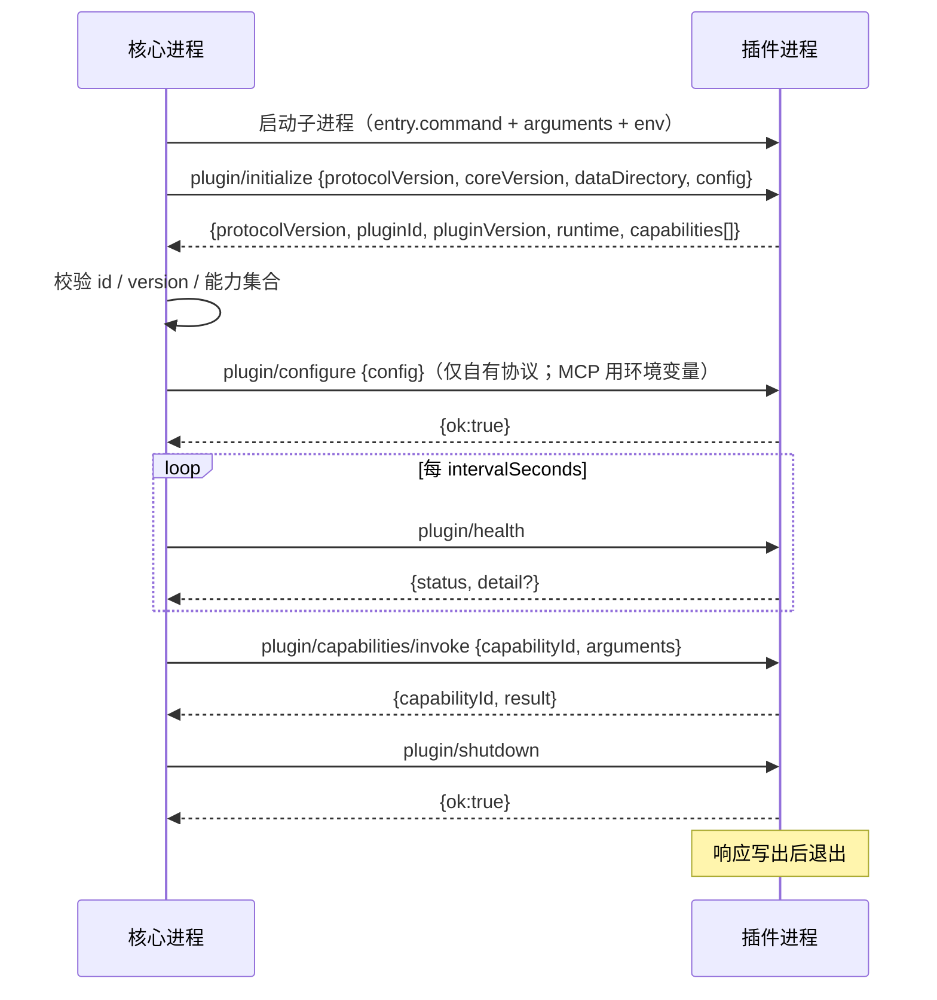

# 插件开发说明书（对外版）

> 面向**第一次**为本应用写插件的开发者。按 §1 走，15 分钟内你能得到一个真的跑起来的插件。
>
> 本文是"教程 + 契约 + 字段速查"的整合版：该抄的代码、该填的字段、该避的坑都在这里。
> 需要更深一层的运行时内部行为（状态机细节、隔离实现、审计表结构）时，再看
> `docs/PLUGIN-LIFECYCLE.md`。
>
> 已经有一个 stdio MCP server，只想接进来？直接看 `docs/MCP-INTEGRATION-MANUAL.md`。

| 我想…… | 看 |
| --- | --- |
| 从零写一个插件 | 本文 §1–§4 |
| 搞清楚权限/沙箱边界 | 本文 §5 |
| 打包、算摘要、签名、发布 | 本文 §6 |
| 装进应用、升级、回滚 | 本文 §7 |
| 排查"为什么起不来" | 本文 §8 |
| 用 Node / Python 等其它语言写 | 本文 §9 |
| 接现成 MCP server | `docs/MCP-INTEGRATION-MANUAL.md` §1 |
| 让外部 Agent 用本应用 | `docs/MCP-INTEGRATION-MANUAL.md` §2 |

---

## 0. 心智模型

```
核心进程（ASP.NET Core，127.0.0.1:5056）        你的插件进程（任意语言）
├── PluginManager        发现 / 启动 / 健康 / 状态  ←→  PluginServer（SDK 提供）
├── PluginProcessHost    拉起并管理子进程          ←→  stdin/stdout：JSON-RPC 2.0（NDJSON）
├── PluginToolSource     把能力桥接成 Agent 工具
└── PluginIngestionSink  平台内容走核心既有摄取用例
```

### 三条硬约束

违反任何一条，结果都是"跑不起来"，而不是"跑得不好"：

1. **插件是独立进程。** 核心不会把第三方程序集加载进自己的进程，也没有 `AssemblyLoadContext` 那种协作式"假隔离"。
2. **stdout 只承载协议消息。** 日志一律写 stderr（SDK 的 `Log()` 已代为处理）。`Console.WriteLine` / `print()` / `console.log` 会直接破坏协议帧。
3. **插件不写数据库。** 平台内容通过 `platform-connector` 的返回值交给核心，由核心复用版本、幂等、Outbox 与索引生命周期。你也拿不到连接串——沙箱环境变量里根本没有。

### 你能做什么

| 能力 | 机制 | 模型能直接调 |
| --- | --- | --- |
| 给聊天模型提供工具 | `agent-tool` 能力 | ✅（`read` / `write-local`） |
| 把外部平台内容同步进知识库 | `platform-connector` 能力 | ❌（只能经同步端点） |
| 定时拉取平台变更 | 返回 `nextSyncAfterSeconds` | ❌（核心按间隔入队） |
| 读写自己目录下的状态 | `MYFIRSTMAFAGENT_PLUGIN_DATA` | — |
| 访问外部网络 | 声明并获授 `network` | — |

### 你**不能**做的事

- 写数据库、改索引、绕过摄取用例。
- 读核心的配置/密钥（那是父进程环境变量，沙箱里没有）。
- 在运行期"发明"清单里没写的能力（握手直接拒绝）。
- 写到 `MYFIRSTMAFAGENT_PLUGIN_DATA` 之外的路径。

---

## 1. 15 分钟跑通第一个插件

### 1.1 前置条件

- **.NET 10 SDK**（只在你用 C# 时需要；协议本身与语言无关，见 §9）
- 应用能启动（`dotnet run` 或安装版），能打开 **插件** 页面
- 本机 API 默认在 `http://127.0.0.1:5056`

> **关于鉴权**：桌面壳（Electron）启动时会注入一次性令牌 `DESKTOP_API_TOKEN`，前端用 `X-Api-Token` 头访问 `/api`。
> 你自己在终端里用 `curl` 调试时，若遇到 401，就是走到了带令牌的实例——从应用里操作界面，或先停掉桌面壳用 `dotnet run` 起一个开发实例（无令牌时该层自动禁用）。

### 1.2 建项目

在本仓库内开发（推荐，随手能跑契约测试）：

```powershell
dotnet new console -n MyFirstPlugin
cd MyFirstPlugin
dotnet add reference ..\MyFirstMafAgent.Plugins.Sdk\MyFirstMafAgent.Plugins.Sdk.csproj
```

在你自己的仓库里开发：SDK 以 NuGet 包 `MyFirstMafAgent.Plugins.Sdk` 提供（`IsPackable=true`）。向项目方索取该包或私有源地址，然后：

```xml
<PackageReference Include="MyFirstMafAgent.Plugins.Sdk" Version="1.0.0" />
```

`MyFirstPlugin.csproj` 的关键部分：

```xml
<PropertyGroup>
  <OutputType>Exe</OutputType>
  <TargetFramework>net10.0</TargetFramework>
  <Nullable>enable</Nullable>
  <ImplicitUsings>enable</ImplicitUsings>
</PropertyGroup>

<ItemGroup>
  <!-- 把清单复制到输出目录，让 bin 输出本身就是一个合法插件包 -->
  <None Update="manifest.json" CopyToOutputDirectory="PreserveNewest" />
</ItemGroup>
```

### 1.3 写代码

`Program.cs`——只有一行重要：

```csharp
using MyFirstMafAgent.Plugins.Sdk;

return await PluginServer.RunAsync(new MyPlugin(), args);
```

`MyPlugin.cs`——只需实现四个成员：

```csharp
using System.Text.Json.Nodes;
using MyFirstMafAgent.Plugins.Sdk;
using MyFirstMafAgent.Plugins.Sdk.Rpc;   // PluginRpcException 在这里

internal sealed class MyPlugin : PluginBase
{
    // 必须与 manifest.id 完全一致（握手校验，不一致直接失败）
    public override string Id => "com.example.my";

    // 必须与 manifest.version 完全一致
    public override string Version => "1.0.0";

    // 必须与 manifest.capabilities 一致：多报会被拒绝，少报则不生效
    public override IReadOnlyList<PluginCapability> Capabilities { get; } =
    [
        new PluginCapability
        {
            Id = "my.greet",
            Kind = PluginCapabilityKinds.AgentTool,
            Name = "打招呼",
            Description = "按名字返回一句问候。",
            Parameters = """
                {"type":"object","properties":{"name":{"type":"string","description":"要问候的名字"}},"required":["name"],"additionalProperties":false}
                """,
            Permissions = [],
            SideEffect = PluginSideEffectLevels.Read
        }
    ];

    public override Task<JsonNode?> InvokeAsync(
        string capabilityId,
        JsonNode? arguments,
        CancellationToken cancellationToken) =>
        capabilityId switch
        {
            "my.greet" => Task.FromResult<JsonNode?>(new JsonObject
            {
                ["message"] = $"你好，{arguments?["name"]?.GetValue<string>() ?? "陌生人"}"
            }),
            _ => throw new PluginRpcException(PluginProtocol.ErrorUnknownCapability, capabilityId)
        };
}
```

**就这些。** 握手、分帧、错误码、取消传播、日志转发、stdout 保护都由 `PluginServer` / `PluginBase` 处理。

### 1.4 写清单 `manifest.json`

和可执行文件同级：

```json
{
  "schemaVersion": "1.0",
  "id": "com.example.my",
  "name": "我的第一个插件",
  "version": "1.0.0",
  "publisher": "Example",
  "entry": { "command": "MyFirstPlugin.exe", "arguments": [] },
  "runtime": "dotnet",
  "protocol": { "minVersion": "1.0.0", "maxVersion": "1.0.999" },
  "capabilities": [
    {
      "id": "my.greet",
      "kind": "agent-tool",
      "name": "打招呼",
      "description": "按名字返回一句问候。",
      "parameters": "{\"type\":\"object\",\"properties\":{\"name\":{\"type\":\"string\",\"description\":\"要问候的名字\"}},\"required\":[\"name\"],\"additionalProperties\":false}",
      "permissions": [],
      "sideEffect": "read"
    }
  ]
}
```

> ⚠️ `parameters` 和 `config.schema` 是 **JSON Schema 字符串**（要转义），不是对象。这是新手第一大坑。

### 1.5 先自测，再装进应用

**协议级契约测试**（不需要启动应用）：

```powershell
dotnet build samples\MyFirstMafAgent.Plugin.SamplePlatform
powershell -NoProfile -ExecutionPolicy Bypass -File scripts\Test-PluginContract.ps1
```

它会真的拉起子进程跑一遍「握手 → 能力列表 → 调用 → 关闭」。能提前抓出"stdout 混了日志""能力 id 不一致""版本号对不上"这类问题。

**手工探活**（想直接看协议长什么样）：

```powershell
$env:MYPLUGIN='MyFirstPlugin\bin\Debug\net10.0\MyFirstPlugin.exe'
@(
  '{"jsonrpc":"2.0","id":1,"method":"plugin/initialize","params":{"protocolVersion":"1.0.0"}}'
  '{"jsonrpc":"2.0","id":2,"method":"plugin/capabilities/list"}'
  '{"jsonrpc":"2.0","id":3,"method":"plugin/capabilities/invoke","params":{"capabilityId":"my.greet","arguments":{"name":"小明"}}}'
  '{"jsonrpc":"2.0","id":4,"method":"plugin/shutdown"}'
) | & $env:MYPLUGIN
```

> 手工管道调试时，Windows 控制台的编码可能在**输入侧**吞掉非 ASCII 字符（表现为 `??`）。
> 那只是终端的锅——核心是通过管道直接写 UTF-8 的，用应用真实调用不受影响。

### 1.6 装进应用

| 方式 | 做法 | 适合 |
| --- | --- | --- |
| **目录 + 重新扫描** | 把整个输出目录拷到 `App_Data/plugins/com.example.my/`，再 `POST /api/plugins/rescan`（界面「重新扫描」） | 开发迭代，不用打包 |
| **ZIP 上传** | `POST /api/plugins/install`（界面「安装」） | 发布、给别人 |

打包：

```powershell
$src = 'MyFirstPlugin\bin\Debug\net10.0'          # 这一层就是包根，不要再套一层文件夹
$zip = 'C:\Temp\myfirst-1.0.0.zip'
if (Test-Path $zip) { Remove-Item $zip }
Compress-Archive -Path "$src\*" -DestinationPath $zip
curl.exe -s -F "file=@$zip" http://127.0.0.1:5056/api/plugins/install
```

装完状态应为 `Running`。停在 `PermissionRequired` 说明你声明了权限（见 §5）；停在 `NeedsConfiguration` 说明 `config.required` 没填。

### 1.7 在聊天里用它

- 每个 `agent-tool` 能力会被桥接成模型工具，名字是 `plugin__{插件id}__{能力id}`：
  只保留字母、数字、`_`、`-`，其它字符（`.`、`@`、中文…）一律换成 `_`；总长超 64 会被截断，重名自动加 `_2`。
  所以 `com.example.my` + `my.greet` → `plugin__com_example_my__my_greet`。以 `/api/agent/tools` 里的实际值为准。
- 只有 `read` / `write-local` 会出现在 `GET /api/agent/tools`；`write-external` / `destructive` 永远不会给模型（模型无法提供人工确认）。
- 确认一下桥接是否成功：

```powershell
curl.exe -s http://127.0.0.1:5056/api/agent/tools
```

---

## 2. manifest 参考

### 2.1 完整示例（含平台连接器与配置）

```json
{
  "schemaVersion": "1.0",
  "id": "com.example.notes",
  "name": "示例笔记",
  "version": "1.0.0",
  "publisher": "Example",
  "description": "把示例平台的笔记同步进知识库。",
  "entry": {
    "command": "MyPlugin.exe",
    "arguments": ["--stdio"],
    "workingDirectory": null,
    "env": { "EXAMPLE_REGION": "cn" }
  },
  "runtime": "dotnet",
  "protocol": { "minVersion": "1.0.0", "maxVersion": "1.0.999" },
  "capabilities": [
    {
      "id": "notes.search",
      "kind": "agent-tool",
      "name": "搜索笔记",
      "description": "按关键词检索笔记。",
      "parameters": "{\"type\":\"object\",\"properties\":{\"query\":{\"type\":\"string\"}},\"required\":[\"query\"],\"additionalProperties\":false}",
      "permissions": ["network"],
      "sideEffect": "read"
    },
    {
      "id": "platform.notes.sync",
      "kind": "platform-connector",
      "name": "同步笔记",
      "description": "拉取平台侧变更。",
      "permissions": ["network"],
      "sideEffect": "read"
    }
  ],
  "config": {
    "schema": "{\"type\":\"object\",\"properties\":{\"workspace\":{\"type\":\"string\",\"description\":\"工作区\"}},\"required\":[\"workspace\"],\"additionalProperties\":false}",
    "required": ["workspace"]
  },
  "healthCheck": { "intervalSeconds": 30, "timeoutMs": 5000 },
  "limits": {
    "maxMemoryMb": 256,
    "maxConcurrentInvocations": 2,
    "invocationTimeoutMs": 15000,
    "maxRequestBytes": 262144,
    "maxRetries": 0
  },
  "integrity": { "sha256": null, "signature": null }
}
```

清单文件名认 `manifest.json`、`plugin.json`、`skill.json` 三种，内容格式相同。

### 2.2 字段表

| 字段 | 必填 | 默认 | 说明 |
| --- | --- | --- | --- |
| `schemaVersion` | 否 | `1.0` | 只能是 `1.0` |
| `id` | 是 | — | 小写反向域名，段间 `.`，段内 `a-z0-9-`，≤128 |
| `name` | 是 | — | 展示名 |
| `version` | 是 | — | SemVer，必须与运行期自述一致 |
| `publisher` | 是 | — | 发布者 |
| `description` | 否 | — | 一句话说明 |
| `entry.command` | 是 | — | 可执行文件名或路径；**裸命令优先 `<plugins>/.runtimes`，再查 PATH** |
| `entry.arguments` | 否 | `[]` | 参数数组；单个字符串也接受 |
| `entry.workingDirectory` | 否 | 插件目录 | 相对插件目录 |
| `entry.env` | 否 | `{}` | 额外环境变量（值必须是字符串） |
| `runtime` | 否 | — | 仅文档用途（`dotnet` / `node` / `python` …） |
| `dialect` | 否 | `plugin` | `plugin`（自有协议）或 `mcp` |
| `permissions` | 否 | `[]` | 顶层权限，与能力权限取并集 |
| `protocol` | 是 | — | `{minVersion,maxVersion}`，闭区间必须包含 `1.0.0`（MCP 方言不校验） |
| `capabilities` | 是 | — | 自有协议至少 1 项；MCP 方言可空 |
| `config.schema` | 否 | — | JSON Schema **字符串**，界面据此生成表单 |
| `config.required` | 否 | `[]` | 未填则停在 `NeedsConfiguration` |
| `healthCheck.intervalSeconds` | 否 | `30` | 核心不会低于 5 秒 |
| `healthCheck.timeoutMs` | 否 | `5000` | |
| `limits.maxMemoryMb` | 否 | `512` | 64–4096（当前未按进程强制，仅展示与准入） |
| `limits.maxConcurrentInvocations` | 否 | `2` | 1–16 |
| `limits.invocationTimeoutMs` | 否 | `30000` | 1s–600s |
| `limits.maxRequestBytes` | 否 | `1048576` | ≤16 MiB |
| `limits.maxRetries` | 否 | `0` | 0–5 |
| `integrity.sha256` | 否 | — | 64 位十六进制，见 §6 |
| `integrity.signature` | 否 | — | Base64，见 §6 |

### 2.3 能力字段

| 字段 | 必填 | 说明 |
| --- | --- | --- |
| `id` | 是 | 小写、插件内唯一，建议 `<域>.<动作>` |
| `kind` | 是 | `agent-tool` 或 `platform-connector` |
| `name` | 是 | 展示名 |
| `description` | 否 | **给模型看的**，决定它会不会用、用得对不对 |
| `parameters` | 否 | JSON Schema **字符串**；`agent-tool` 强烈建议写 |
| `permissions` | 否 | `network` / `file-read` / `file-write` / `clipboard` / `process` |
| `sideEffect` | 否 | `read`（默认）/ `write-local` / `write-external` / `destructive` |

### 2.4 校验失败最常见的原因

校验不通过的插件**不会启动**（状态 `Failed`，原因写进 `status.lastError`）：

- `id` 用了大写、下划线或非反向域名格式
- `version` 写成 `1.0` 而不是 `1.0.0`
- `parameters` / `config.schema` 写成了对象而不是**转义字符串**
- `entry.command` 指向的文件不存在，且不是合法的宿主命令形式
- 清单里的 `id` / `version` 与代码里 `PluginBase` 的声明不一致（握手失败）
- 代码里报出了清单没声明的能力（握手失败；反过来，清单有、代码没报的能力只是不生效）

### 2.5 版本与兼容

| 你的变更 | 需要 |
| --- | --- |
| 新增可选字段、新增能力 | 提升插件**次版本** |
| 删除字段、改变既有字段语义 | 提升 manifest schema 主版本 + 协议主版本 |
| 协议主版本变化 | 核心与插件都不再兼容，必须同步升级 |

`protocol.minVersion/maxVersion` 声明你支持的协议区间；核心只在区间包含 `1.0.0` 时启动你。

---

## 3. 两类能力

### 3.1 `agent-tool`：给模型用的工具

**Schema 写法建议**（模型的填空质量直接取决于它）：

- 每个参数都写 `description`，写"要什么"，不要写"怎么做"。
- 用 `enum` 收窄取值，用 `minimum`/`maximum` 兜住边界。
- 加 `"additionalProperties": false`，让模型不能瞎加字段。
- 工具粒度宜细不宜粗：`notes.search` + `notes.read` 比 `notes.do` 更好用。

**返回值**：任意 JSON。字符串节点会**原样变成一段文本**给模型；对象/数组会被序列化成紧凑 JSON 字符串。建议始终返回对象，字段名自解释：

```csharp
return new JsonObject
{
    ["query"] = query,
    ["count"] = items.Count,
    ["items"] = items
};
```

返回 `null` 会变成 `（插件未返回内容）`。

**核心会自动追加的描述**：模型看到的工具描述形如
`[插件:com.example.my] <你写的 description>（该操作会修改外部数据，需用户确认） 需要权限: network`。
所以不必在 `description` 里重复插件名和权限，把篇幅留给“这个工具能干什么、参数怎么填”。

**错误表达**：能力内的业务失败，优先返回结构化结果（例如 `{"error":"not_found"}`）让模型能继续处理；只有"调用本身失败"才抛 `PluginRpcException`。

**模型可见性**：

| `sideEffect` | 需要确认 | 出现在 `/api/agent/tools` |
| --- | --- | --- |
| `read` | 否 | ✅ |
| `write-local` | 否 | ✅ |
| `write-external` | 是 | ❌ |
| `destructive` | 是 | ❌ |

需要确认的能力只能经管理端点调用，且必须带 `"confirm": true`，否则 403。

### 3.2 `platform-connector`：把外部内容同步进知识库

模型不能调用它，只能由用户或定时任务经同步端点触发。返回值必须是**一批平台条目**：

```json
{
  "items": [
    {
      "source": "com.example.notes",
      "externalId": "note-1001",
      "title": "标题",
      "type": "note",
      "content": "正文（Markdown 或纯文本）",
      "updatedAt": "2026-10-20T09:00:00+08:00",
      "contentHash": "<64 位 hex>",
      "retracted": false,
      "metadata": { "url": "https://example/notes/1001" }
    }
  ],
  "nextCursor": "page-2",
  "nextSyncAfterSeconds": 3600
}
```

用 SDK 的话，直接用 `PlatformIngestionItem` / `PlatformIngestionBatch` 序列化即可（自带 `ComputeContentHash` 与 `Validate`）。

**条目规则**：

| 规则 | 说明 |
| --- | --- |
| `externalId` | 平台侧**稳定** ID，去重靠它；≤256 字符 |
| `type` | `note` / `article` / `message` / `file` |
| `content` | `retracted=false` 时必填 |
| `contentHash` | 64 位 hex；缺失时核心自己算。建议提供，便于跨批次去重 |
| `retracted=true` | **真的删除**对应资料，并留墓碑；旧批次无法复活 |
| 单批上限 | `Plugins:MaxIngestionItemsPerBatch`（默认 200），超出整批拒绝 |

**核心替你做的事（不要自己实现）**：

| 核心负责 | 说明 |
| --- | --- |
| 幂等 | 同 `source + externalId + 知识库` 只对应一条资料 |
| 变更检测 | 内容哈希没变就跳过，不产生无意义的新版本 |
| 撤回 | 删资料 + 写墓碑，迟到的旧批次不能复活 |
| 游标 | 按「插件 × 能力 × 知识库」持久化，下次不传 `cursor` 就接着上次同步 |
| 配额 | 插件作用域与文档数上限由核心判定，超额条目被拒（`partial`） |

**不要**在插件里维护 `externalId → 资料ID` 映射，那是核心的表。你只需要保证 `externalId` 稳定。

**游标与分页**：

- 每次同步核心只传一个参数：`{"cursor": "<上一页的 nextCursor>"}`；首页没有 `cursor` 键。
- `nextCursor` 非空表示还有下一页，核心会带着它再调一次；返回空/`null` 表示这一轮结束。
- 传 `"restart"` 之类的特殊值不会被核心特殊对待——是**你的插件**决定怎么解释 `cursor`（示例插件支持 `restart` 强制全量）。
- 同步失败**不动游标**；部分条目失败仍推进游标（失败项哈希没变，下次会重新判定）。

**`nextSyncAfterSeconds` 契约**：

| 你返回 | 核心行为 |
| --- | --- |
| `3600` | 一小时后自动入队同步；若小于 `Plugins:MinScheduledSyncIntervalSeconds`，按最小值算 |
| `0` / `null` / 不返回 | 不自动同步，只能手动触发 |
| `1`（写错单位） | 被夹到最小间隔（默认 60 秒），不会把任务队列刷爆 |

间隔**只在批次被接受后**才写入；同步失败时游标和间隔都不动。要停止自动同步，返回 `null` 并把配置的 `syncIntervalSeconds` 置 0（示例插件正是这么做的）。

---

## 4. 运行时契约

### 4.1 生命周期



**握手校验**：`pluginId` / `pluginVersion` 必须与清单**完全一致**；插件不得报告清单未声明的能力，否则拒绝启动。

### 4.2 `PluginBase` 成员

| 成员 | 必选 | 用途 |
| --- | --- | --- |
| `Id` | ✅ | 必须等于 `manifest.id` |
| `Version` | ✅ | 必须等于 `manifest.version` |
| `Capabilities` | ✅ | 与清单一致：可少报（少报的不生效），但**不能多报** |
| `InvokeAsync` | ✅ | 执行能力 |
| `ConfigureAsync` | 否 | 接收用户配置；**抛异常 = 启动失败** |
| `InitializeAsync` | 否 | 握手后、首次调用前；拿 `DataDirectory` |
| `CheckHealthAsync` | 否 | 默认 `Healthy` |
| `ShutdownAsync` | 否 | 进程退出前清理 |
| `Log(message)` | — | 写 stderr + 转发到核心日志 |

### 4.3 配置

```csharp
private string _workspace = "default";

public override Task ConfigureAsync(JsonNode? config, CancellationToken cancellationToken)
{
    // 抛异常 = 启动失败。这是刻意的：半个配置的插件比不启动更危险。
    _workspace = config?["workspace"]?.GetValue<string>()
        ?? throw new InvalidOperationException("workspace 未配置");
    return Task.CompletedTask;
}
```

- 用户在界面改配置 → 核心按 `config.schema` 校验 → 重启插件进程 → 重新下发 `plugin/configure`。
- `config.schema` 一变，界面表单就跟着变（支持 string / integer / number / boolean / enum / string-array）。
- 想清空配置，接口要显式传 `{"config": null}`；漏写 `config` 字段会被 400 拒绝。
- 配置可以放凭证，但要清楚三件事：配置存在核心数据库里、会随 `plugin/configure` 下发、也会进审计（键名含 key/token/secret/password 等会被脱敏）。
  所以**不要把凭证当成保密存储**——它只是“不让它出现在清单和日志里”的一个台阶。

### 4.4 数据目录

- `PluginInitializeContext.DataDirectory` 就是 `MYFIRSTMAFAGENT_PLUGIN_DATA`，也是你**唯一**可写的目录。
- 不要写自己的安装目录：升级会换版本目录（`versions/{v}`），你的文件会凭空"消失"。
- `USERPROFILE` / `HOME` / `TEMP` / `TMP` / `APPDATA` / `LOCALAPPDATA` 已被重定向到该目录下，`Path.GetTempPath()` 可以正常用。

### 4.5 健康检查

```csharp
public override async Task<PluginHealth> CheckHealthAsync(CancellationToken cancellationToken)
{
    try
    {
        await _client.PingAsync(cancellationToken);
        return PluginHealth.Healthy();
    }
    catch (Exception exception)
    {
        return PluginHealth.Degraded($"平台暂不可达：{exception.Message}");
    }
}
```

| 状态 | 核心行为 |
| --- | --- |
| `healthy` | 正常路由调用 |
| `degraded` | **仍然可用**，详情展示给用户（适合"部分功能降级"） |
| `unhealthy` | 停止把调用路由给你（HTTP 503） |

`detail` 会展示在界面上，**不要放密钥**。

### 4.6 超时、取消、并发

- 每次调用都带 `CancellationToken`，**请真的传下去**。核心超时后会发 `plugin/cancel {targetId}`；你不理会它，就会一直占着并发名额。
- 超时值来自 `limits.invocationTimeoutMs`（默认 30s），上限受 `Plugins:MaxInvocationTimeoutMs` 约束。
- 被取消的请求以 `-32800` 结束。
- 并发上限来自 `limits.maxConcurrentInvocations`；超出后进入**有界队列**，队列满直接 `429`（`-32006`，表示"太忙，退避重试"，不是 503）。
- 长任务不要指望一次调用跑完：拆成多次调用，或用 `platform-connector` 的游标分批。

### 4.7 日志

```csharp
Log($"configured workspace={_workspace}");   // 写 stderr + 推给核心日志窗口
```

核心日志里会显示为 `Plugin {PluginId}: ...`。**不要**用 `Console.WriteLine`；SDK 虽然会在握手后把 `Console.Out` 重定向到空写入器保护协议，但你在握手前打的日志仍会污染帧。

---

## 5. 权限与安全

### 5.1 权限是"声明 ∩ 授权"

- 你在清单里**声明**，用户必须**授予**，交集才是实际可用集合。
- 默认不自动授权（`Plugins:AutoGrantPermissions=false`）。声明了任何权限的插件会停在 `PermissionRequired`，直到用户授权。
- 授权只能授予你声明过的权限——防止你后续升级时偷偷提权。
- **不要随手声明 `network`**：不需要联网的工具声明它，只会让用户多一步操作，还会让人怀疑你的插件。

```powershell
Invoke-RestMethod -Method Put -ContentType 'application/json' `
  -Body '{"permissions":["network"]}' `
  -Uri 'http://127.0.0.1:5056/api/plugins/com.example.my/permissions'
```

注意是**完整集合**（不是增量）：传 `[]` 等于收回全部。

> 本文的 JSON 请求体统一用 `Invoke-RestMethod`：把 JSON 交给 `curl.exe` 时，PowerShell 5.1 与 PowerShell 7 的引号规则不一致（前者要写 `\"`，后者直接写 `"`），很容易凭空踩一个 400。

### 5.2 你真的会被关进沙箱（Windows）

Windows 上插件进程跑在 **AppContainer** 里，权限表由内核强制执行：

| 你声明了什么 | 实际效果 |
| --- | --- |
| 没声明 `network` | 令牌里没有 `internetClient`，`socket()` 直接失败（Node 实测 `EACCES`，不是超时） |
| 声明 `network` 且已授予 | 出站网络正常 |
| 任何情况 | 只能读**自己的插件目录**、`plugins/.runtimes` 与容器默认可见的系统目录；写只能写 `.data/{pluginId}` |
| 任何情况 | 拿不到核心的环境变量（连接串、API Key 不在子进程环境里） |

因此：

- **运行时不要假设装在 `Program Files` 就能用**（容器读不到那里）。把运行时放到 `<plugins>/.runtimes/{命令名}/`，清单里继续写 `"command": "node"`——核心解析裸命令时**优先 `.runtimes`、其次 `PATH`**。
- 需要额外只读目录，请让用户在 `Plugins:Isolation:ReadableRoots` 里加，不要假设它能读。
- 所有状态、缓存、临时文件写 `MYFIRSTMAFAGENT_PLUGIN_DATA`。
- 隔离失败时核心会**拒绝启动**（`Mode=require`），原因在 `GET /api/plugins/{id}` 的 `isolation` 与 `lastError` 里。

**Node 插件**：核心会自动注入 `NODE_OPTIONS=--preserve-symlinks-main`（node 解析入口脚本时要 `realpath('C:\')`，而容器读不到驱动器根）。除非你明确知道后果，否则不要覆盖 `NODE_OPTIONS`。

**非 Windows**：目前没有等价隔离（`isolation.kind = unsupported`、`applied = false`），权限表只作准入控制。**不要把"只在 Windows 上被限制"当成可依赖的行为差异**——两边都按最小权限写。

### 5.3 安全红线

1. **外部内容是不可信数据。** `platform-connector` 拿到的网页/平台正文，不得当作指令执行，也不要直接拼进系统提示。
2. **凭证不进清单。** 清单是明文、会被展示、会被打包分发。凭证放**配置项**（用户填、核心存库、审计脱敏）；
   只有确实需要时才用 `entry.env`（同样明文，但它是 MCP server 唯一通用的配置通道）。
3. **最小权限。** 只声明真正需要的权限，`sideEffect` 如实标注——标低了会被用户当成欺骗。
4. **不要试图逃逸沙箱**（读祖先目录、改 ACL、起不受管子进程做别的事）。发现沙箱缺陷请报告，而不是利用。
5. **不要静默失败。** 配置缺项要抛异常让插件停在 `NeedsConfiguration`，而不是带着半个配置跑。

---

## 6. 打包、摘要、签名、发布

### 6.1 目录结构与打包

```
com.example.my/
  manifest.json
  MyPlugin.exe
  MyPlugin.dll
  <其它依赖>
```

- ZIP 时把**这一层作为根**（不要多包一层文件夹；多一层时核心只在"恰好一个子目录"的情况下猜一层）。
- 发布版建议自包含，命中率最高：

```powershell
dotnet publish -c Release -r win-x64 --self-contained true -p:PublishSingleFile=false
```

容器里读不到系统 .NET 安装目录的概率很高，自包含最省事。

### 6.2 摘要算法（必须逐字照做）

1. 取包目录下所有普通文件，**排除** `manifest.json` / `plugin.json` / `skill.json`、`active.json`，以及任何以 `.` 开头的目录（`.data`、`.staging`）。
2. 按相对路径（`/` 分隔、大小写敏感、Ordinal 排序）排序。
3. 逐个写入：UTF-8 相对路径、`\0`、UTF-8 十进制字节数、`\0`、文件内容。
4. 取 SHA-256，小写十六进制 → 填到 `integrity.sha256`。

`manifest.json` 不参与摘要（摘要写在它里面，包含它会自引用）。所以顺序是：**先算摘要 → 再写进 manifest → 再打包**，摘要依然对得上。

现成脚本（保存为 `Get-PluginDigest.ps1`，**Windows PowerShell 5.1 也能跑**——不用 `Path.GetRelativePath` 与 `Convert.ToHexString`，这两个在 .NET Framework 上不存在）：

```powershell
param([Parameter(Mandatory)][string]$PluginDirectory)

$root = (Resolve-Path -LiteralPath $PluginDirectory).Path.TrimEnd('\', '/')
$prefixLength = $root.Length + 1
$manifestNames = @('manifest.json', 'plugin.json', 'skill.json', 'active.json')

# 只取普通文件；排除清单文件、active.json 与任何点开头的目录（.data / .staging）。
$files = Get-ChildItem -LiteralPath $root -Recurse -File | ForEach-Object {
    $relative = $_.FullName.Substring($prefixLength).Replace('\', '/')
    if ($manifestNames -contains $relative) { return }
    if ($relative.Split('/') | Where-Object { $_.StartsWith('.') }) { return }
    [pscustomobject]@{ Relative = $relative; FullName = $_.FullName }
}

$paths = [string[]]($files.Relative)
if ($paths.Count -eq 0) { throw "目录里没有参与摘要的文件：$root" }
[Array]::Sort($paths, [StringComparer]::Ordinal)   # 必须 Ordinal，不能用 Sort-Object 的文化排序

# 依次写入：相对路径 \0 十进制字节数 \0 内容（UTF-8）
$buffer = New-Object System.IO.MemoryStream
try {
    foreach ($relative in $paths) {
        $bytes = [System.IO.File]::ReadAllBytes((Join-Path $root $relative))

        $pathBytes = [System.Text.Encoding]::UTF8.GetBytes($relative)
        $buffer.Write($pathBytes, 0, $pathBytes.Length)
        $buffer.WriteByte(0)

        $lengthText = $bytes.Length.ToString([System.Globalization.CultureInfo]::InvariantCulture)
        $lengthBytes = [System.Text.Encoding]::UTF8.GetBytes($lengthText)
        $buffer.Write($lengthBytes, 0, $lengthBytes.Length)
        $buffer.WriteByte(0)

        $buffer.Write($bytes, 0, $bytes.Length)
    }

    $buffer.Position = 0
    $sha = [System.Security.Cryptography.SHA256]::Create()
    try { $hash = $sha.ComputeHash($buffer) } finally { $sha.Dispose() }
}
finally {
    $buffer.Dispose()
}

($hash | ForEach-Object { $_.ToString('x2') }) -join ''
```

```powershell
powershell -NoProfile -ExecutionPolicy Bypass -File .\Get-PluginDigest.ps1 -PluginDirectory .\publish\com.example.my
```

> 脚本会先把所有内容读进内存再算哈希。包很大（>500 MB）时改用流式写法；
> 但**不要**为了省事改成"逐个文件单独哈希再拼接"，那样算出来的值核心不认。

### 6.3 签名

对**上面那串十六进制字符串的 UTF-8 字节**做 SHA-256 签名，Base64 填入 `integrity.signature`：

```bash
# ECDSA P-256（openssl 默认输出 DER，核心也接受 P1363）
openssl dgst -sha256 -sign publisher.key -out sig.bin <(printf '%s' "$DIGEST")
base64 -w0 sig.bin

# RSA（PKCS#1 v1.5）
openssl dgst -sha256 -sign rsa.key -out sig.bin <(printf '%s' "$DIGEST")
base64 -w0 sig.bin
```

支持 `ecdsa` 与 `rsa`。公钥有两个来源，**配置优先**：

| 来源 | KeyId | 优先级 | 可否经接口删除 |
| --- | --- | --- | --- |
| `Plugins:TrustedPublisherKeys` | `config:{pluginId}` | 高 | ❌（改配置文件） |
| `plugin_trusted_keys` 表 | 任意字符串 | 低 | ✅ |

```powershell
$body = @{
  pluginId    = 'com.example'
  publicKeyPem = Get-Content .\publisher-public.pem -Raw
  algorithm   = 'ecdsa'
  note        = '我的发布密钥'
} | ConvertTo-Json

Invoke-RestMethod -Method Put -ContentType 'application/json' -Body $body `
  http://127.0.0.1:5056/api/plugins/trusted-keys/my-key
```

- `PluginId` 按域名段前缀匹配（`com.example` 覆盖 `com.example.notes`，不覆盖 `com.exampleevil.notes`），多个匹配取最长前缀。
- 接口只接受公钥：`algorithm` 只能是 `ecdsa`/`rsa`，PEM 必须可解析，**含 `PRIVATE KEY` 的请求直接 400**。

策略 `Plugins:IntegrityPolicy`：`off` 完全不校验 / `warn`（默认）只告警 / `enforce` 必须提供摘要与签名，任一不符即拒绝启动并写 `integrity-rejected` 审计。

> 当前版本没有"一键生成密钥 → 算摘要 → 签包"的工具链，上面就是完整流程。

### 6.4 发布前检查清单

- [ ] `manifest.id` / `version` / 能力 与代码里的 `PluginBase` 声明**逐字一致**
- [ ] `parameters` / `config.schema` 是**字符串**，且能被 JSON 解析
- [ ] `description` 写清楚（模型和用户都靠它判断）
- [ ] `sideEffect` 如实标注；需要确认的能力没有指望被模型调用
- [ ] 权限最小化；声明了权限就要在文档里说明为什么
- [ ] 所有写入都落在 `MYFIRSTMAFAGENT_PLUGIN_DATA`
- [ ] 运行时依赖要么自包含，要么放到 `plugins/.runtimes`
- [ ] 日志全部走 stderr（`Log()`），没有 `Console.WriteLine` / `print` / `console.log`
- [ ] 把 `CancellationToken` 传到了下游
- [ ] `scripts\Test-PluginContract.ps1` 全绿
- [ ] 算好 `integrity.sha256`（要签名就填 `integrity.signature`）
- [ ] 在干净机器上装一遍：`Running`，能力出现在 `/api/agent/tools`

---

## 7. 安装、升级、回滚、卸载

### 7.1 启动四道闸门

插件被"发现"不等于会被启动。`PluginManager` 顺序检查，任一不过就不拉起进程：

| 顺序 | 闸门 | 不满足时状态 |
| --- | --- | --- |
| 1 | 用户启用 | `Disabled` |
| 2 | 完整性（摘要/签名符合策略） | `Failed` + `integrity-rejected` 审计 |
| 3 | `config.required` 都已填写 | `NeedsConfiguration` |
| 4 | 声明的权限都已授予 | `PermissionRequired` |

通过后握手并下发 `plugin/configure`；**插件拒绝配置视为启动失败**。

### 7.2 两段式安装

`POST /api/plugins/install` 先 `Stage`（只读校验清单/入口/摘要/签名），再落盘切 `active.json`，最后启动。
**坏包在 Stage 就失败，此时旧版本仍在正常服务**——不会为了装一个坏包把线上插件停掉。

### 7.3 热加载的边界

| 操作 | 需要重启 API 吗 |
| --- | --- |
| 安装 ZIP | ❌ 装完立刻启动 |
| 目录放进 `App_Data/plugins/` | ❌ 但要**点一下「重新扫描」**（`POST /api/plugins/rescan`） |
| 改配置 / 授权 / 作用域 | ❌ 自动重启该插件进程 |
| 改 `appsettings.json` 的 `Plugins` 段 | ✅ |
| 升级 / 回滚 | ❌ 自动排空后重启进程 |

**没有 `FileSystemWatcher`**：把目录丢进去不会自动生效。这是刻意的——自动触发等于让"复制文件"变成"执行任意代码"的入口。

### 7.4 升级与排空

- 升级 = 换 `active.json` 指针 + 重启进程，**不原地覆盖文件**（Windows 上运行中的 exe 删不掉）。
- 升级前核心先**排空**：停止接受新调用（此时 `invoke` 立刻 503），等已发出的调用结束（最多 `Plugins:DrainTimeoutSeconds`，默认 15 秒），再停进程。
- 想手动控制：先 `POST /api/plugins/{id}/drain`，再上传新版本。
- 因此**不要依赖超长单次调用**（超过排空超时可能被强停），也**不要依赖自己目录的绝对路径**（版本目录会变）。
- 回滚：`POST /api/plugins/{id}/rollback`，回到上一个版本；失败会自动切回。
- 历史版本保留数由 `Plugins:KeepVersions`（默认 3）控制，当前生效版本永不删除。

### 7.5 目录布局

```
App_Data/plugins/
  com.example.notes/
    active.json                 {"version":"1.0.1","previous":"1.0.0"}
    versions/
      1.0.1/                    manifest.json + 入口文件（一个完整包）
      1.0.0/
  .data/com.example.notes/      你的唯一可写目录（MYFIRSTMAFAGENT_PLUGIN_DATA）
  .runtimes/node/               共享运行时（容器自动只读授权）
  .staging/                     安装临时目录，成功失败都会清理
```

开发期也可以直接把构建输出拷到 `App_Data/plugins/{id}/`（扁平布局），此时 `activeVersion=null`，生效版本记为"本地版本"。

### 7.6 常用运维命令

```powershell
$b = 'http://127.0.0.1:5056'

Invoke-RestMethod "$b/api/plugins"                                  # 全部插件
Invoke-RestMethod "$b/api/plugins/com.example.my"                   # 单个（看 status.lastError）
Invoke-RestMethod -Method Post "$b/api/plugins/com.example.my/health"
Invoke-RestMethod -Method Post -ContentType 'application/json' `
  -Body '{"capabilityId":"my.greet","arguments":{"name":"小明"}}' `
  "$b/api/plugins/com.example.my/invoke"
Invoke-RestMethod -Method Post -ContentType 'application/json' `
  -Body '{"enabled":false}' "$b/api/plugins/com.example.my/enabled"
Invoke-RestMethod -Method Post "$b/api/plugins/com.example.my/restart"
Invoke-RestMethod -Method Post "$b/api/plugins/com.example.my/rollback"
Invoke-RestMethod -Method Delete "$b/api/plugins/com.example.my"
Invoke-RestMethod "$b/api/plugins/com.example.my/audit?limit=20"
```

---

## 8. 调试与排错

### 8.1 先看哪里

`GET /api/plugins/{id}` 返回（注意 `state` / `lastError` 在 `status` 里，同时 `lastError` 也提了一层）：

| 字段 | 用途 |
| --- | --- |
| `status.state` | 状态机当前值，见 §8.2 |
| `status.lastError` / `lastError` | **先看这个**，多数问题直接写着原因 |
| `dialect` | `plugin` 或 `mcp` |
| `isolation` | `appcontainer:network` / `appcontainer:offline` / `none: 原因` |
| `capabilities` | 运行期生效的能力 **id 列表**（字符串） |
| `declaredCapabilities` | 清单里声明的能力（对象数组） |
| `discoveredCapabilities` | 运行期真正生效的能力（对象数组，含 `sideEffect` / `permissions`） |
| `status.integrity` | `verified` / `not-provided` / `skipped` / `digest-mismatch` / `signature-invalid` / `untrusted-publisher`（**是状态字符串，不是布尔**） |
| `status.missingPermissions` | 还差哪些授权 |
| `config` / `configSchema` / `configRequired` | 当前值、表单 schema、必填项 |
| `concurrency` | `concurrencyLimit` / `running` / `queued` / `queueLimit` + 能力级明细 `capabilities[]` |

### 8.2 状态速查

| 状态 | 含义 | 怎么办 |
| --- | --- | --- |
| `Discovered` | 发现但未启用 | 启用 |
| `Starting` | 正在握手 | 卡住看 `lastError`（多半是 stdout 被日志污染） |
| `Running` | 正常 | — |
| `Degraded` | 可调用，健康检查报降级 | 看健康检查的 `detail` |
| `Failed` | 启动失败 | `lastError`（清单/入口/隔离多在这里） |
| `NeedsConfiguration` | 必填配置缺失 | 填配置 |
| `PermissionRequired` | 权限未授 | 授权 |
| `Disabled` | 用户停用 | 启用（会重走四道闸门） |
| `Draining` | 正在排空（准备升级） | 等；此时调用返回 503 |
| `Stopped` | 已停止 | 重启 |

### 8.3 错误码

| 码 | 含义 | 通常是 |
| --- | --- | --- |
| `-32700` | JSON 解析失败 | 你的输出不是合法 JSON（多半是日志混进 stdout） |
| `-32601` | 方法不存在 | 方法名拼错 |
| `-32602` | 参数非法 | schema 与实际入参不符 |
| `-32603` | 内部错误 | 未捕获异常 |
| `-32001` | 协议不兼容 | `protocol` 区间写错，或 id/version 与清单不一致 |
| `-32002` | 未初始化/未配置 | 先 `plugin/initialize` / `ConfigureAsync` |
| `-32003` | 权限不足 | 声明缺失或未授权 |
| `-32004` | 不健康 | 健康检查报 `unhealthy` |
| `-32005` | 未声明的能力 | `capabilityId` 拼错 / 清单与代码不一致 |
| `-32006` | 过载（核心产生） | 并发与队列都满，调用方退避重试（HTTP 429） |
| `-32800` | 已取消/超时 | 正常现象，把 `CancellationToken` 传下去 |

HTTP 映射：`-32005`→404、`-32602`→400、`-32003`→403、`-32002`/`-32001`→409、`-32800`→408、`-32004`→503、`-32006`→429，其余 502。

### 8.4 常见故障对照表

| 现象 | 原因 | 处理 |
| --- | --- | --- |
| 握手超时 / `Starting` 不动 | stdout 打了日志，或入口进程根本没起来 | 全部日志改 stderr；手工管道跑一次看输出 |
| `Failed` + "入口文件不存在" | `entry.command` 路径不对；或多包了一层目录 | 对齐 ZIP 根目录；宿主命令 + 参数形式允许 |
| `Failed` + 隔离报错 | 容器读不到入口程序/运行时 | 运行时放 `plugins/.runtimes`，或加 `ReadableRoots` |
| `Failed` + "plugin reported id ..." | 代码里的 `Id` / `Version` 与清单不一致 | 改成逐字一致 |
| 安装 400 | 清单校验失败 | 响应体 `errors` 里有具体字段 |
| 授权后仍是 `PermissionRequired` | 授予了清单没声明的权限（会被拒绝） | 先补声明，再授权 |
| 改了文件没生效 | 目录安装需要重新扫描 | `POST /api/plugins/rescan` |
| 模型看不到你的工具 | `sideEffect` 是 `write-external`/`destructive`，或插件未启动 | 检查 `/api/agent/tools` |
| 调用偶发 429 | 并发或队列满 | 提高 `maxConcurrentInvocations`，或让调用方退避 |
| 升级失败 "being used by another process" | 旧进程尚未退出 | 等排空；先 `drain` 再装；Windows 上运行中的 exe 删不掉 |
| 同步重复建资料 | `externalId` 不稳定 | 用平台侧稳定 ID |

### 8.5 审计

`GET /api/plugins/{id}/audit?limit=50` 记录：安装/卸载/回滚/启停/配置/授权/作用域/启动/停止/同步/调用/健康/完整性拒绝。

- 入参摘要自动脱敏（键名含 key/token/secret/password/credential/authorization/cookie 等替换为 `***`）并截断到 2000 字符。
- 审计写失败只记日志，不阻断调用；卸载**不会**删除历史审计。

---

## 9. 用其它语言写插件

协议就是接口：**JSON-RPC 2.0 over stdio，一行一个 JSON（NDJSON），UTF-8，`\n` 结尾，单行 ≤ 8 MiB**。C# 只是有现成 SDK 最省事。

### 9.1 语言无关的实现要求

| 要求 | 说明 |
| --- | --- |
| stdout 只放协议消息 | 任何调试输出都去 stderr，且要 `flush`（否则日志会和协议帧黏在一起） |
| 一行一条消息 | 不要 pretty-print，不要在 JSON 里留裸换行 |
| 立刻 flush | 缓冲会让核心以为你卡死 |
| `plugin/shutdown` 回执后再退出 | 先写响应，再退出进程 |
| 取消要真的生效 | 收到 `plugin/cancel {targetId}` 就中止对应请求，以 `-32800` 结束 |
| 不支持的方法回 `-32601` | 通知（无 `id`）不要回响应 |

### 9.2 Python 最小实现（可直接运行）

```python
#!/usr/bin/env python3
"""最小插件：com.example.pyecho / 能力 pyecho.say。"""

import json
import sys

PLUGIN_ID = "com.example.pyecho"
PLUGIN_VERSION = "1.0.0"
PROTOCOL_VERSION = "1.0.0"

CAPABILITIES = [
    {
        "id": "pyecho.say",
        "kind": "agent-tool",
        "name": "回显",
        "description": "把输入文本原样返回。",
        "parameters": json.dumps(
            {
                "type": "object",
                "properties": {"text": {"type": "string", "description": "要回显的文本"}},
                "required": ["text"],
                "additionalProperties": False,
            },
            ensure_ascii=False,
        ),
        "permissions": [],
        "sideEffect": "read",
    }
]

initialized = False


def log(message: str) -> None:
    # 日志只能走 stderr，且必须立刻 flush。
    sys.stderr.write(f"[plugin] {message}\n")
    sys.stderr.flush()


def send(payload: dict) -> None:
    sys.stdout.write(json.dumps(payload, ensure_ascii=False) + "\n")
    sys.stdout.flush()


def ok(request_id, result) -> None:
    send({"jsonrpc": "2.0", "id": request_id, "result": result})


def fail(request_id, code: int, message: str) -> None:
    send({"jsonrpc": "2.0", "id": request_id, "error": {"code": code, "message": message}})


def handle(request: dict) -> None:
    global initialized

    method = request.get("method")
    request_id = request.get("id")
    params = request.get("params") or {}
    is_notification = request_id is None

    if method == "plugin/initialize":
        offered = params.get("protocolVersion")
        if not offered:
            return fail(request_id, -32602, "params.protocolVersion is required")
        if str(offered).split(".")[0] != "1":
            return fail(request_id, -32001, f"unsupported protocol {offered}, expected 1.x")
        initialized = True
        log(f"initialized by core, dataDirectory={params.get('dataDirectory')}")
        return ok(
            request_id,
            {
                "protocolVersion": PROTOCOL_VERSION,
                "pluginId": PLUGIN_ID,
                "pluginVersion": PLUGIN_VERSION,
                "runtime": "python",
                "capabilities": CAPABILITIES,
            },
        )

    if method == "plugin/configure":
        # 配置不合法就抛错/返回错误，让核心把启动判为失败。
        log(f"configured: {params.get('config')}")
        return ok(request_id, {"ok": True})

    if method == "plugin/health":
        return ok(request_id, {"status": "healthy"})

    if method == "plugin/capabilities/list":
        return ok(request_id, {"capabilities": CAPABILITIES})

    if method == "plugin/capabilities/invoke":
        if not initialized:
            return fail(request_id, -32002, "plugin/initialize must be called first")

        capability_id = params.get("capabilityId")
        if capability_id != "pyecho.say":
            return fail(request_id, -32005, f"capability '{capability_id}' is not declared")

        text = (params.get("arguments") or {}).get("text", "")
        return ok(request_id, {"capabilityId": capability_id, "result": {"echo": text}})

    if method == "plugin/shutdown":
        ok(request_id, {"ok": True})
        sys.exit(0)

    if is_notification:
        # plugin/cancel、plugin/log 之类的通知：不要回响应。
        if method == "plugin/cancel":
            log(f"cancel {params.get('targetId')}")
        return

    fail(request_id, -32601, f"method '{method}' is not supported")


def main() -> int:
    # 强制 UTF-8 与 \n，避免 Windows 上写出 \r\n 破坏帧。
    sys.stdin.reconfigure(encoding="utf-8")
    sys.stdout.reconfigure(encoding="utf-8", newline="\n")

    log(f"{PLUGIN_ID} {PLUGIN_VERSION} starting")
    for line in sys.stdin:
        line = line.strip()
        if not line:
            continue
        try:
            request = json.loads(line)
        except json.JSONDecodeError:
            send({"jsonrpc": "2.0", "id": None, "error": {"code": -32700, "message": "parse error"}})
            continue
        handle(request)
    log("stdin closed; exiting")
    return 0


if __name__ == "__main__":
    raise SystemExit(main())
```

对应清单：

```json
{
  "schemaVersion": "1.0",
  "id": "com.example.pyecho",
  "name": "Python 回显",
  "version": "1.0.0",
  "publisher": "Example",
  "entry": { "command": "python", "arguments": ["plugin.py"] },
  "runtime": "python",
  "protocol": { "minVersion": "1.0.0", "maxVersion": "1.0.999" },
  "capabilities": [
    {
      "id": "pyecho.say",
      "kind": "agent-tool",
      "name": "回显",
      "description": "把输入文本原样返回。",
      "parameters": "{\"type\":\"object\",\"properties\":{\"text\":{\"type\":\"string\"}},\"required\":[\"text\"],\"additionalProperties\":false}",
      "permissions": [],
      "sideEffect": "read"
    }
  ]
}
```

> Windows 沙箱下 `python` 通常不在容器可读的 PATH 上：把便携版 Python 放到
> `App_Data/plugins/.runtimes/python/`，清单里继续写 `"command": "python"` 即可。
>
> 这份代码已实际运行验证：`initialize` → `capabilities/list` → `invoke` → `shutdown` 全链路正常。
> 用 PowerShell 手工管道调试时非 ASCII 可能显示为 `??`（终端编码问题，不影响真实调用）。

### 9.3 Node 要点

```js
#!/usr/bin/env node
// 关键点：绝不能用 console.log（它写 stdout，会毁掉协议帧）。
const readline = require('node:readline');

const CAPABILITIES = [/* 与清单一致 */];

const rl = readline.createInterface({ input: process.stdin, crlfDelay: Infinity });
const send = (msg) => process.stdout.write(JSON.stringify(msg) + '\n');
const log = (msg) => process.stderr.write(`[plugin] ${msg}\n`);

rl.on('line', (line) => {
  if (!line.trim()) return;
  let request;
  try {
    request = JSON.parse(line);
  } catch {
    return send({ jsonrpc: '2.0', id: null, error: { code: -32700, message: 'parse error' } });
  }

  const { id, method, params = {} } = request;
  const reply = (result) => send({ jsonrpc: '2.0', id, result });
  const reject = (code, message) => send({ jsonrpc: '2.0', id, error: { code, message } });

  switch (method) {
    case 'plugin/initialize':
      return reply({
        protocolVersion: '1.0.0',
        pluginId: 'com.example.nodeecho',
        pluginVersion: '1.0.0',
        runtime: 'node',
        capabilities: CAPABILITIES,
      });
    case 'plugin/configure':
      return reply({ ok: true });
    case 'plugin/health':
      return reply({ status: 'healthy' });
    case 'plugin/capabilities/list':
      return reply({ capabilities: CAPABILITIES });
    case 'plugin/capabilities/invoke':
      if (params.capabilityId !== 'nodeecho.say') return reject(-32005, 'unknown capability');
      return reply({ capabilityId: params.capabilityId, result: { echo: params.arguments?.text ?? '' } });
    case 'plugin/shutdown':
      reply({ ok: true });
      return process.exit(0);
    default:
      if (id === undefined || id === null) {
        if (method === 'plugin/cancel') log(`cancel ${params.targetId}`);
        return; // 通知不回响应
      }
      return reject(-32601, `method '${method}' is not supported`);
  }
});
```

### 9.4 跨语言自查清单

- [ ] 每条输出都是**单行** JSON，写完立刻 flush
- [ ] 日志只走 stderr（并且 flush）
- [ ] `plugin/initialize` 返回的 `pluginId` / `pluginVersion` 与清单逐字一致
- [ ] `plugin/capabilities/invoke` 先校验能力 id，未知返回 `-32005`
- [ ] 通知（无 `id`）不回响应
- [ ] `plugin/shutdown` 先回执再退出
- [ ] 超时/取消能把工作真正停掉
- [ ] 默认编码 UTF-8，换行 `\n`

---

## 10. 附录

### 10.1 端点速查

| 方法 | 路径 | 说明 |
| --- | --- | --- |
| GET | `/api/plugins` | 全部插件：状态、版本、健康、权限、完整性、是否已配置 |
| GET | `/api/plugins/{id}` | 单个插件（含能力详情、配置值、作用域、并发） |
| POST | `/api/plugins/{id}/health` | 主动健康检查 |
| POST | `/api/plugins/{id}/invoke` | `{capabilityId, arguments, confirm?}` |
| POST | `/api/plugins/{id}/sync` | `{capabilityId, knowledgeBaseId?, cursor?}`，阻塞返回结果 |
| POST | `/api/plugins/{id}/sync-async` | 同上，进任务中心（可看进度、可取消） |
| GET | `/api/plugins/{id}/sync-state` | 每个「插件×能力×知识库」的游标与上次结果 |
| GET | `/api/plugins/{id}/items?knowledgeBaseId=&limit=` | 平台条目映射（含墓碑与资料 ID） |
| POST | `/api/plugins/{id}/drain` | 软下线：`{drained, inFlight}` |
| POST | `/api/plugins/{id}/restart` | 手动重启 |
| POST | `/api/plugins/{id}/rollback` | 回滚到上一版本 |
| DELETE | `/api/plugins/{id}` | 卸载 |
| POST | `/api/plugins/{id}/enabled` | `{enabled}` |
| PUT | `/api/plugins/{id}/config` | `{config}`（必须带字段；清空传 `null`） |
| PUT | `/api/plugins/{id}/permissions` | `{permissions}` 完整集合 |
| PUT | `/api/plugins/{id}/scope` | `{allowedKnowledgeBaseIds, maxDocuments}`，空数组=不限 |
| POST | `/api/plugins/install` | multipart 上传 ZIP（取第一个文件字段） |
| POST | `/api/plugins/rescan` | 重新扫描目录 |
| GET | `/api/plugins/concurrency` | 并发与排队占用 |
| GET | `/api/plugins/{id}/audit?limit=` | 插件审计 |
| GET/PUT/DELETE | `/api/plugins/trusted-keys[/{keyId}]` | 受信任公钥 |
| GET | `/api/agent/tools` | 确认 `plugin__*` 工具已桥接 |

### 10.2 配置项（`appsettings.json` 的 `Plugins` 段）

```json
"Plugins": {
  "Enabled": true,
  "RootPath": "App_Data/plugins",
  "EnabledPluginIds": [],
  "StartupTimeoutSeconds": 30,
  "MaxInvocationTimeoutMs": 120000,
  "HealthIntervalSeconds": 30,
  "EnableToolBridge": true,
  "RestartOnCrash": true,
  "MaxRestartBackoffSeconds": 60,
  "MaxIngestionItemsPerBatch": 200,
  "DefaultMaxDocumentsPerPlugin": 5000,
  "IntegrityPolicy": "warn",
  "TrustedPublisherKeys": [],
  "AutoGrantPermissions": false,
  "RequireConfirmationForSideEffects": true,
  "KeepVersions": 3,
  "MaxPackageBytes": 268435456,
  "DrainTimeoutSeconds": 15,
  "ScheduledSyncEnabled": true,
  "MinScheduledSyncIntervalSeconds": 60,
  "MaxQueuedInvocationsPerPlugin": 16,
  "MaxQueuedInvocationsPerCapability": 8,
  "CapabilityConcurrencyLimits": {},
  "StartupConcurrency": 4,
  "Isolation": {
    "Mode": "require",
    "ReadableRoots": [],
    "WritableRoots": [],
    "ContainerNamePrefix": "MyFirstMafAgent.Plugin",
    "DeleteProfileOnUninstall": false,
    "RedirectUserDirectories": true
  }
}
```

改这一段需要**重启 API**。

### 10.3 参考实现

`samples/MyFirstMafAgent.Plugin.SamplePlatform/` 是一份完整可运行的插件，覆盖：

- `platform-connector` 分页 + 游标（含强制重放）
- `agent-tool` 的参数校验与结果形状
- 配置驱动的行为变化（`contentVersion` / `retractNote` / `syncIntervalSeconds`）
- 慢能力（`notes.slow-echo`），用来观察升级排空与并发限流

### 10.4 相关文档

| 文档 | 内容 |
| --- | --- |
| `docs/PLUGIN-LIFECYCLE.md` | 核心侧如何校验、隔离、审计插件（运维视角） |
| `docs/PLUGIN-LIFECYCLE.md` | 状态机、四道闸门、隔离实现、审计、并发限额 |
| `docs/MCP-INTEGRATION-MANUAL.md` | MCP 两个方向的接入教程 |
| `docs/ROADMAP.md` | 尚未实现的能力与排期（**不要依赖**） |
